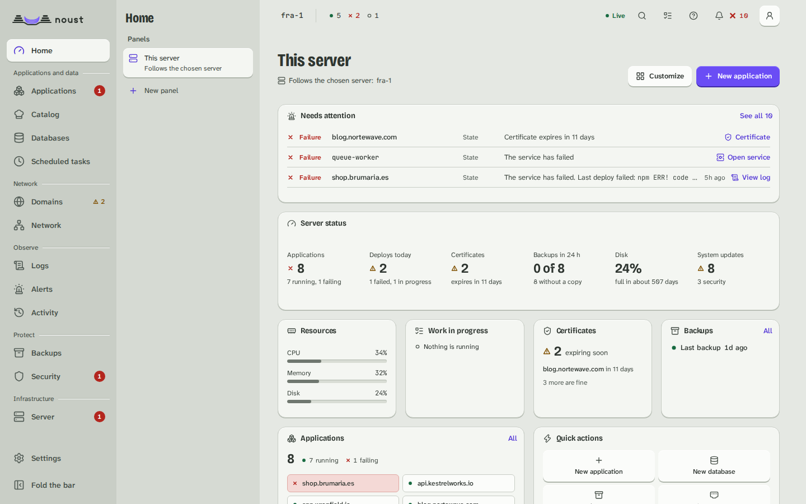

> **Noust 4.3** looks after all of Docker on a server, lets a machine that only has Docker deploy, and fixes a
> vulnerability in the check on Docker Compose files that affects 3.1.0 to 4.2.1
> ([Security](https://noust.dev/docs/releases/changelog-4.3/#security)): update, then run `noust health`. Read
> [docs/UPGRADING-4.3.md](https://noust.dev/docs/releases/upgrading-4.3/) before updating; what changed is in
> [docs/CHANGELOG-4.3.md](https://noust.dev/docs/releases/changelog-4.3/), and every earlier release has its own changelog in [docs/](https://github.com/Perkybeet/noust/tree/main/docs).

<h1 align="center">
  <picture>
    <source media="(prefers-color-scheme: dark)" srcset="https://raw.githubusercontent.com/Perkybeet/noust/main/docs/brand/noust-wordmark-dark.svg">
    
  </picture>
</h1>

<p align="center">
  <a href="https://noust.dev">Website</a> ·
  <a href="https://noust.dev/docs/">Documentation</a> ·
  <a href="https://noust.dev/docs/start/install/">Install</a> ·
  <a href="https://github.com/Perkybeet/noust/releases">Releases</a> ·
  <a href="https://github.com/Perkybeet/noust/discussions">Discussions</a> ·
  <a href="https://github.com/Perkybeet/noust/issues/new/choose">Report a problem</a>
</p>

<p align="center">
  <a href="https://github.com/Perkybeet/noust/actions/workflows/ci.yml">
    
  </a>
  <a href="https://github.com/Perkybeet/noust/releases/latest">
    
  </a>
  <a href="https://build.opensuse.org/package/show/home:Perkybeet/noust">
    
  </a>
  <a href="https://pypi.org/project/noust/">
    
  </a>
  <a href="https://pepy.tech/projects/noust">
    
  </a>
  <a href="https://pypi.org/project/noust/">
    
  </a>
  <a href="https://github.com/Perkybeet/noust/blob/main/LICENSE">
    
  </a>
  <a href="https://github.com/Perkybeet/noust/stargazers">
    
  </a>
</p>

**Your server, Vercel-grade. No Docker required.**

In Orkney and Shetland, a *noust* is the hollow on the shore where a boat is drawn up and
sheltered between voyages. Your server is the noust, and your applications are the boats.

Noust deploys web applications onto a Linux server you own and keeps them running. Point it
at a repository and a domain: it builds the application, runs it as a systemd unit behind
nginx or Apache, obtains its certificate, and from then on every deploy is a new release
that only goes live if it answers, and can be undone in seconds. The same engine is driven
from the CLI, a browser console and a JSON API.



---

## Install

On a fresh server, as root:

```bash
curl -fsSL https://noust.dev/install.sh | sh
```

That address redirects to the installer of the latest release. The installer is published with
every release beside its checksum (and the checksum's signature). To check it before you run it:

```bash
curl -fsSLO https://github.com/Perkybeet/noust/releases/latest/download/install.sh
curl -fsSLO https://github.com/Perkybeet/noust/releases/latest/download/SHA256SUMS
sha256sum -c --ignore-missing SHA256SUMS && sh install.sh
```

It reads the distribution and the architecture and refuses what is not on the
[platform list](https://noust.dev/docs/start/platforms/); adds the Noust repository after checking that the key it
serves has the fingerprint pinned in the script; installs the `noust` package with `apt`, `dnf`
or `zypper` (the RHEL family has no package, so it gets a virtual environment with pip); runs
`noust setup init -y` and `noust web enable`; and prints how to reach the console. It downloads
no other script. `sh install.sh --dry-run` prints what it would do and changes nothing.

[docs/install.md](https://noust.dev/docs/start/install/) has the whole path to a signed-in console, and the other
ways: by hand on Ubuntu, Debian, Fedora and openSUSE, from PyPI, from source, and the container
image that runs a central.

---

## First deploy

```bash
noust setup init                                                   # web server, certbot, git, Node.js, directories
noust create -d shop.example.com -s https://github.com/you/shop.git   # detect, build, run, serve, certificate
noust status shop.example.com                                      # how it is configured, whether it runs
noust update shop.example.com                                      # after a push: a new release behind the health check
noust releases rollback shop.example.com                           # back to the previous release, in seconds
```

`noust create` detects the application type, installs and builds it in a new release under
`/var/www/apps/shop-example-com/`, writes a systemd unit and an nginx site pointing at
`current`, obtains a Let's Encrypt certificate, and keeps the release only if the
application answers. When the repository has an `.env.example`, a `.env` is generated from
it, with random values for secrets. Useful options: `--type`, `--port`, `--branch`, `--www`,
`--webserver apache`, `--no-ssl`, `--persist storage`, `--env-file`. For a private repository,
create a deploy key with `noust setup ssh --generate --show` and use the SSH URL, or connect
the GitHub App: private repositories then clone with one-hour installation tokens passed through
git's environment only, never in a URL, `.git/config`, a command line or a log.

Detection tries the most specific type first: monorepo, Docker Compose, Angular, Astro, Nuxt,
Remix, SvelteKit, Next.js, PHP, Vite, Python, Go, Ruby, Rust, Node.js, static. When nothing
matches, Noust falls back to Node.js and says so; pass `--type` to choose.

Run `noust` with a command and `--help` for its options, or `noust -i` for an interactive
menu. `--dry-run` before any command rehearses it without changing anything, and `--json`
gives machine-readable output where supported. Global options go before the command: `-v` (verbose),
`--dry-run`, `--json`, `--no-color`, `--reason` (why, for the audit log), `-i`, `--changelog`,
`-V` (version). Tab completion: `noust setup completions`. The reference configuration is
`/usr/share/noust/config.example.yaml`. The guide that goes on from here, to a domain, a
database, a backup and a way back, starts at
[Deploy your first application](https://noust.dev/docs/start/first-application/).

---

## The console

```bash
noust web enable          # a systemd service on 127.0.0.1:8080; prints an access token
```

The console listens on loopback unless you give it TLS, so opening the server's address in a
browser will not reach it. Reach it through an SSH tunnel from your own machine; the banner
prints the exact line:

```bash
ssh -L 8080:127.0.0.1:8080 root@server.example.com    # then open http://localhost:8080
```

To open it from a browser without a tunnel, publish it on a name of your own, over TLS, with
Noust's own nginx and Let's Encrypt:

```bash
noust console expose --domain console.example.com --allow-ip 203.0.113.0/24
noust console unexpose                  # removes exactly what the line above made
```

The first time, sign in with the access token: the console asks you to create the first
account, an administrator (and, recommended, a security officer for someone else). From then
on people sign in with their account, a password and an authenticator code, or a passkey, and
the access token is emergency access. See
[docs/console.md](https://noust.dev/docs/reference/console/start/#reaching-it).

---

## Where to go next

The documentation is at [noust.dev/docs](https://noust.dev/docs/), arranged by the question you have.

| You want to | Read |
|---|---|
| Know what Noust is, and whether it is for you | [What Noust is, and when it is not for you](https://noust.dev/docs/start/what-is-noust/) and [how it works](https://noust.dev/docs/start/how-noust-works/) |
| Deploy a first application, and put it on your domain | [Deploy your first application](https://noust.dev/docs/start/first-application/), then [put it on your domain, with HTTPS](https://noust.dev/docs/start/domain-and-https/) |
| Deploy a stack, a Docker Compose project or a container | [Deploy by stack](https://noust.dev/docs/guides/frameworks/), [build and start commands](https://noust.dev/docs/guides/build/), [Docker Compose](https://noust.dev/docs/guides/compose/), [container applications](https://noust.dev/docs/guides/containers/) and [Docker](https://noust.dev/docs/guides/compose/docker/) |
| Install a ready-made application | [Install and update a recipe](https://noust.dev/docs/guides/recipes/) |
| Go back to an earlier release, or deploy without a cut | [Roll back to a release or a deployment](https://noust.dev/docs/guides/releases/) and [deploys without downtime](https://noust.dev/docs/guides/releases/deploys/) |
| Keep data safe | [Databases](https://noust.dev/docs/guides/databases/) and [back up applications and databases](https://noust.dev/docs/guides/backups/) |
| Be told when something fails | [Notifications and alerts](https://noust.dev/docs/guides/notifications/) and [the resource monitor](https://noust.dev/docs/guides/monitor/) |
| Manage several servers from one console | [Run a central](https://noust.dev/docs/guides/fleet/) |
| Give people access, and publish the console safely | [Security of the console and the server](https://noust.dev/docs/guides/security/) and [ENS, category MEDIUM](https://noust.dev/docs/guides/ens/) (in Spanish) |
| Move from another platform | [From Coolify](https://noust.dev/docs/guides/from-coolify/), [Dokploy](https://noust.dev/docs/guides/from-dokploy/), [CapRover](https://noust.dev/docs/guides/from-caprover/) or [Dokku](https://noust.dev/docs/guides/from-dokku/) |
| Look up a command, an API operation or a setting | [Every command](https://noust.dev/docs/reference/cli/), [the API](https://noust.dev/docs/reference/api/) and [every setting](https://noust.dev/docs/reference/configuration/) |
| Fix something that is wrong | [Troubleshooting](https://noust.dev/docs/guides/troubleshooting/), one page per symptom, with the messages word for word |

---

## What Noust is, and is not

**It is**

- **Your server.** A VPS or a bare-metal machine running Ubuntu, Debian, Fedora or openSUSE.
- **systemd-native.** Every application is a unit you can inspect with `systemctl` and
  `journalctl`; every site is a file in `/etc/nginx` or `/etc/apache2`. Nothing sits between
  you and your processes, and there is no daemon with a privileged socket.
- **A distribution package.** Installed with `apt`, `dnf` or `zypper`, or from PyPI.
- **Atomic deploys with instant rollback.** Each deploy builds in its own directory, is
  activated behind a health check, rolls back by itself when it does not answer, and any
  release still on disk can be reactivated in seconds.
- **A deploy queue.** A push that arrives while an application builds waits its turn instead
  of failing, and several pushes are one update.
- **Per-application resource limits** with cgroups: memory, CPU and tasks.
- **Builds without root.** Dependencies install and build as an unprivileged account in a
  systemd sandbox that cannot read the rest of the machine, and every application created from
  3.2 runs as a system account of its own.
- **A console and an API** over exactly what the CLI does, with accounts and roles, passkeys
  and two-factor authentication, sudo mode, four-eyes approvals and a tamper-evident audit log.
- **The server too**: operating-system updates, SSH, the firewall, fail2ban, disks and swap,
  checked and changed safely from the same console.
- **A terminal in the browser, on the record.** A shell as an application, in its sandbox and
  with its environment, and commands run once; for administrators, a root shell on the server,
  off until it is turned on ([docs/terminal.md](https://noust.dev/docs/guides/terminal/)).
- **Docker, looked after whole.** When the machine has Docker, Server > Docker lists its containers,
  images, volumes and networks whoever made them, says whose each is (an application's, a database
  engine's, Noust's, or nobody's) and offers only what that owner's own way allows
  ([docs/docker.md](https://noust.dev/docs/guides/compose/docker/)).
- **An assistant, if you want one.** Off until an administrator turns it on, with the model you choose;
  it explains and investigates, and what would change something is a proposal a person approves
  ([docs/assistant.md](https://noust.dev/docs/guides/assistant/)).

**It is not**

- **A cluster or an orchestrator.** Each server runs its own applications and manages
  itself. A central manages several Noust servers from one console and acts on many at once
  (see [the fleet](https://noust.dev/docs/guides/fleet/)); it does not schedule work across them.
- **A container orchestrator.** Applications run as ordinary processes. A Dockerfile, an image
  or a Docker Compose project runs in containers on the same machine, under a unit, and Docker
  is needed only for those; Noust looks after what Docker has there and does not schedule
  containers across machines.
- **A container boundary between running applications.** Each application created from 3.2
  runs as an account of its own, so one cannot read another's tree, but they share the kernel
  and the machine. Deploy only code you trust, as you would on any server you administer.

**Security.** Noust administers the machine, so it runs as root, on purpose. An `admin`
account, the access token and any token holding `root_equivalent` can make changes that run as root;
treat them that way, and turn on approvals if one person should not make them alone. See
[docs/security.md](https://noust.dev/docs/guides/security/), which also says how to report a vulnerability, and
[docs/SECURITY-MODEL.md](https://noust.dev/docs/concepts/promises/) for what Noust guarantees, the failure each guarantee
answers, the test that fails if it stops holding, what it does not guarantee, and how to verify a
release's signatures.

**Privacy.** Noust has no telemetry and sends no error reports to anyone. The only request it makes
without being told where is the update check (`noust config set updates.check false` turns it off);
everything else goes to addresses you configured. [docs/PRIVACY.md](https://noust.dev/docs/concepts/privacy/) lists them,
and `tests/test_privacy.py` fails if a change adds a way out that is not declared.

---

## Requirements

- **Operating system and processor**: Debian 12 and 13, Ubuntu 22.04, 24.04 and 26.04, Fedora, openSUSE Leap and Tumbleweed, and the RHEL family through pip; amd64 and arm64, Raspberry Pi 64-bit included ([docs/PLATFORMS.md](https://noust.dev/docs/start/platforms/) says what each is, and what was tested where)
- **Python**: 3.10 to 3.14
- **Privileges**: root
- **Installed by `noust setup init` when missing**: nginx or Apache, certbot, git, Node.js

[Requirements](https://noust.dev/docs/start/requirements/) has the rest, per application type, and what Noust itself costs when it is doing nothing.

---

## Development

```bash
git clone https://github.com/Perkybeet/noust.git
cd noust
python -m venv .venv && source .venv/bin/activate
pip install -e ".[all,dev]"

pytest                          # tests
ruff check src/noust tests      # lint
ruff format src/noust tests     # format
mypy                            # types
```

The console's source is in `panel/` (React, TypeScript, Vite; Node 22). Its build is
committed to `src/noust/web/static/`, so packaging never runs Node. See
[CONTRIBUTING.md](https://github.com/Perkybeet/noust/blob/main/CONTRIBUTING.md) for the project's rules and the console workflow.

---

## License

From 2.1.0, Noust (then under its previous name) is free software under the **GNU Affero General Public License,
version 3 or later** ([LICENSE](https://github.com/Perkybeet/noust/blob/main/LICENSE)). You may use it for anything, commercially
included, study it, change it and share it. If you change Noust and let others use your
changed version over a network (a hosted service, say), you must offer them its source under
the same licence.

Releases up to 2.0.x were published under a non-commercial source-available licence, and stay
under it: the text is the `LICENSE` of each of those tags.

Copyright (c) 2024-2026 Yago López Prado. For a licence on other terms (for example to
embed Noust in a closed product), write to support@noust.dev.

## Acknowledgments

- [Certbot](https://certbot.eff.org/) - SSL certificate automation
- The open-source community

---

## Support

- **Website**: [noust.dev](https://noust.dev)
- **Documentation**: [noust.dev/docs](https://noust.dev/docs/)
- **Questions and ideas**: [GitHub Discussions](https://github.com/Perkybeet/noust/discussions)
- **Bugs and requests**: [GitHub Issues](https://github.com/Perkybeet/noust/issues/new/choose); from the console, **Report a problem** opens the form filled in ([how](https://noust.dev/docs/project/support/))
- **A vulnerability**: privately, see [SECURITY.md](https://github.com/Perkybeet/noust/blob/main/SECURITY.md)
- **Email**: [support@noust.dev](mailto:support@noust.dev)

---

<p align="center">
  Developed by <a href="https://bitbeet.dev">Bitbeet</a>
</p>
