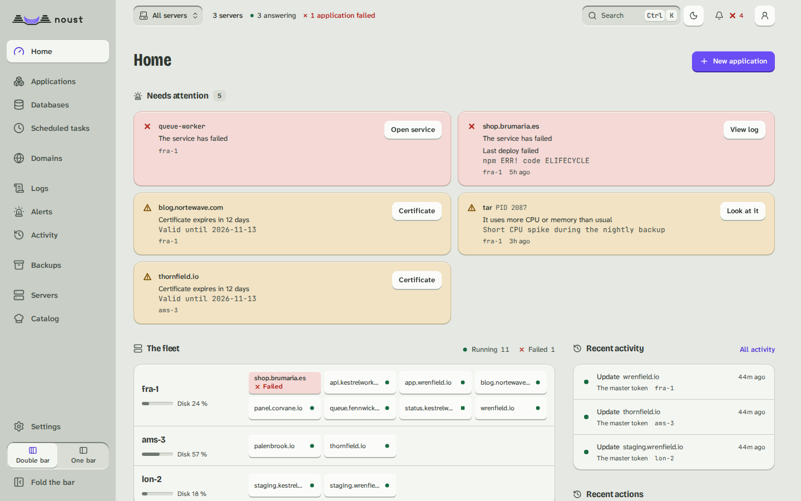

# The Noust central

A **central** is a Noust whose job is to manage your other servers. It opens an SSH tunnel to
each of them and drives them through their own API, from one console. It can be:

- **a container on a NAS or any Docker host** (the recommended home for it: it only dials
  out, so nothing is opened on your router), or
- **a VPS**, either one that only manages the fleet or a server that also deploys its own
  applications.

A central in a container is a **hub** (`central.role = hub`): it deploys nothing itself.
Applications, sites, certificates, databases and the rest are refused there with a message,
and the console hides them. Everything else (the console, tokens, two-factor, the fleet)
works as on any Noust.

What a Noust can do is one table, `src/noust/central/features.py`: each function says what it needs, the server
role and/or a fact of the machine (systemd, a web server, Docker, root, the journal). The refusal of a hub and
the console's choice of what to offer both read it: the session (`GET /api/auth/session`, `central.features`)
says for every function whether it works here and, when it does not, why, in a sentence with a code. A hub in a
container has none of the machine's facts either, so the machine's own pages (its clock, its system log, its
root shell, its firewall) are not offered there; a hub on a VPS keeps them.

The console's own fleet pages (a central's, never a plain server's: **All servers** in the scope
selector) show every server it manages side by side - whether it answers, what it runs, what needs
attention on each - and the selector switches the whole console to one of them; see
[console.md](console-fleet.md#fleet) for its pages.



What the central cannot do matters as much. It reaches each server as **`noust-tunnel`**, an
account `noust fleet authorize` creates for it there: a system account with no home, `nologin`
as its shell and `*` as its password (no password ever matches it). Its keys live in a file of
root's, `/etc/ssh/noust/noust-tunnel.keys`, which it cannot edit, and sshd itself restricts it
with a block Noust writes to `/etc/ssh/sshd_config.d/00-noust-tunnel.conf` (or, when sshd
includes no such directory, at the end of `/etc/ssh/sshd_config`, between marker lines):

```
Match User noust-tunnel
    AuthorizedKeysFile /etc/ssh/noust/%u.keys
    PubkeyAuthentication yes
    AuthenticationMethods publickey
    DisableForwarding no
    AllowTcpForwarding local
    AllowStreamLocalForwarding no
    PermitOpen 127.0.0.1:<console port>
    PermitListen none
    GatewayPorts no
    PermitTunnel no
    PermitTTY no
    X11Forwarding no
    AllowAgentForwarding no
    PermitUserRC no
    ForceCommand /usr/bin/false
```

The key line says the same thing again, so a line copied without its options is still
contained:

```
restrict,port-forwarding,permitopen="127.0.0.1:<console port>",permitlisten="127.0.0.1:1",command="/usr/bin/false" ssh-ed25519 AAAA... noust-central:<central>
```

The central's key can open `ssh -L` to the console's port on loopback and nothing else: no
terminal, no command, no agent, no remote forward, no Unix-socket forward, no other port.
Before sshd is reloaded the change is checked with `sshd -t`, and afterwards
`sshd -T -C user=noust-tunnel,...` must show every one of these settings in force; if another
file or `Match` block wins, the change is put back and `authorize` says which setting differs.
This works on servers with `PermitRootLogin no`, and even with `DisableForwarding yes` for
everyone else. It needs OpenSSH 7.8 or later on the server (Debian 12, Ubuntu 22.04 and later,
Fedora and openSUSE Leap 15 all ship newer).

**Servers enrolled by 3.0.** Up to 3.0 the key went into **root's** `authorized_keys`, and
this page said it could only forward one port. That was not true: `permitlisten` limits TCP
listeners only, so the same key could ask for a remote forward to a *path*
(`ssh -R /etc/nologin:...`) and sshd created that Unix socket **as root**, anywhere - including
`/etc/nologin`, which stops every other account from logging in. Move each such server to the
tunnel account (see [Moving a 3.0 server to the tunnel account](central-servers.md#moving-a-30-server-to-the-tunnel-account)).
`noust node list` flags the ones still reached as root.

The central never gets a shell on a server, each server decides how far the central may go
there ([the access ceiling](fleet-model.md#how-far-a-central-may-go-on-a-server)), and each server can revoke
it on its own.

The central's tunnels also pin their algorithms: ed25519 host keys only (the one the join
code carries), `sntrup761x25519-sha512@openssh.com` (post-quantum hybrid) or
`curve25519-sha256` for the key exchange, `chacha20-poly1305@openssh.com` or
`aes256-gcm@openssh.com` as ciphers, and encrypt-then-MAC MACs only. The central asks its own
`ssh -Q` once and drops what an older client lacks.

The rest of this guide is on pages of its own:

- [Add servers to a central](central-servers.md)
- [Operate the fleet](central-operate.md)
- [Deploy from GitHub on its servers](central-sources.md)
- [Look after the central](central-maintain.md)
- [How a central drives a server](fleet-model.md)

## Install on a UGREEN NAS (UGOS Pro)

1. Open **App Center** and install **Docker** if it is not there.
2. Open **Docker > Project > Create**. Name it `noust`, keep the suggested path, and paste
   [`packaging/container/compose.yaml`](../packaging/container/compose.yaml) as the compose
   file. Press **Deploy**.
3. Open **Container > noust > Log** and copy the line `Access Token: noust_...`. It is shown
   on the first start **only**.
4. Browse to `https://<the NAS address>:8443`. The certificate is self-signed, so the browser
   warns once; the log shows its SHA-256 fingerprint to compare with the one the browser
   shows. Paste the token.

The same with SSH on the NAS, in a folder holding `compose.yaml`:

```bash
sudo docker compose up -d
sudo docker logs noust          # the token and the certificate's fingerprint
```

To keep the data in a folder of the NAS instead of a Docker volume (easier to back up with
the NAS's own tools), create it for the container's user first and switch the `volumes:`
line in `compose.yaml`:

```bash
sudo mkdir -p /volume1/docker/noust
sudo chown 10001:10001 /volume1/docker/noust
```

## Install on any Docker host

```bash
docker volume create noust-data
docker run -d --name noust --restart unless-stopped \
  -p 8443:8443 -v noust-data:/data \
  --read-only --tmpfs /tmp:size=16m --cap-drop ALL \
  --security-opt no-new-privileges:true \
  ghcr.io/perkybeet/noust:latest
docker logs noust
```

The image runs as uid 10001 with a read-only root filesystem and no capabilities; everything
it keeps is under `/data`.

| Variable | Default | What it does |
|----------|---------|--------------|
| `NOUST_ALLOW_IP` | loopback, `10/8`, `172.16/12`, `192.168/16`, `fc00::/7` | Who may open the console, space- or comma-separated. Wins over `web.ip_whitelist`. |
| `NOUST_TLS_CERT`, `NOUST_TLS_KEY` | a self-signed pair minted at the first start | Your own certificate, both on the volume. The recommended way: see [The console's certificate](#the-consoles-certificate). |
| `NOUST_TLS_NAMES` | none | Names and addresses to add to the self-signed certificate, space- or comma-separated (`central.example.com 192.168.1.50`): a container only sees its own addresses, not the NAS's. |
| `NOUST_DATA_DIR` | `/data` | Where everything lives. |
| `NOUST_CENTRAL_ROLE` | `hub` | Set by the image; a container cannot deploy. |

## On a VPS

On a VPS, the central is a normal Noust installed from the packages; there is no container
and no `noust central run`.

- **A VPS that also deploys applications** stays `central.role = server` (the default). It
  manages the fleet from the same console it already has: nothing to change.
- **A VPS that only manages the fleet**: install Noust, then

  ```bash
  noust config set central.role hub
  noust web enable --host 0.0.0.0 --port 8443 --self-signed --allow-ip <your address or VPN range>
  ```

  or keep the console on loopback behind your own reverse proxy (`noust web enable` and
  `--trusted-proxy`). A central reachable from the internet is the one thing to avoid: prefer
  a VPN or an SSH tunnel to it (`ssh -L 8443:127.0.0.1:8443 root@central`).
  A hub has no nginx sites of its own, so `noust console expose` (a name, a certificate and an
  allow-list through Noust's nginx, [docs/console.md](console-start.md#reaching-it)) is for a central
  that also deploys, `central.role = server`; a hub serves its own TLS, as above.

`noust central run` works on a VPS too (as root, or with `NOUST_DATA_DIR` pointing at a
directory its user owns), but `noust web enable` is the supported way to run a console as a
service there.

## First sign-in and accounts

1. Sign in with the token from the first start. A central with no accounts opens **Create the
   first account**: an administrator, and (recommended) a security officer for another person.
   Or from the command line: `docker exec -it noust noust user create alice --role admin`.
2. Sign in as that account and enrol its second factor, an authenticator app or a passkey. Every
   account must have one, and **a central refuses to add its first server without it**. From
   then on the access token is emergency access only.
3. Lost the token? `docker exec -it noust noust web token --new` issues another and retires
   the old one.

The central's accounts are the ones that matter for the fleet: operators reach every server
through the central, and each server receives the operator's name with every call
(`X-Noust-Actor`) and what that person may do (`X-Noust-Actor-Permissions`; roles are editable, so a
role's name does not mean the same on two servers). The server grants those permissions within its
ceiling for the central (below), and never what no central may have: its accounts, security settings
and audit trail. A server before 4.1 reads the name of the widest role of 3.1 the person holds all of
(`X-Noust-Actor-Role`) and decides by its own table. A server's own accounts, tokens and second
factor are never the central's to change.

`docker exec -it noust noust central status` shows the role, where the data is, the
certificate's fingerprint, who may connect, whether the secrets are sealed, how many
servers there are and whether two-factor is on.

## The console's certificate

The central holds the keys of the whole fleet, so its console is served over TLS with a
certificate your browser really trusts. The way to get that is your own: a certificate from your
organisation's CA, or from Let's Encrypt for a name of yours, with `NOUST_TLS_CERT` and
`NOUST_TLS_KEY` (or `--tls-cert`/`--tls-key` outside the container). Chrome and Firefox also
refuse passkeys on a certificate they do not trust, so this is the setup they need.

Without one the first start mints a self-signed certificate: ECDSA P-256, valid 825 days, with
`subjectAltName` for the host name, the machine's FQDN, `localhost`, the addresses of its
interfaces and whatever `NOUST_TLS_NAMES` adds (every current browser ignores the common name,
so a certificate without names could not be trusted by any means). Its fingerprint and expiry
are in `noust central status` and in the first lines of `docker logs`. A pair from an earlier
version (RSA, no names) is replaced once, on the first start of 3.1, and the browser asks about
the new fingerprint once. A self-signed certificate that expires is replaced at the next start.

The console accepts TLS 1.2 at the least, and of the TLS 1.2 suites only ECDHE key exchange with
AES-GCM or ChaCha20-Poly1305. `web.allowed_hosts` (a list of names, `*.example.com` allowed)
makes it answer only the names you give, plus loopback and the host of `web.public_url`; empty
answers any host. Neither a NAS in a cupboard nor a container on a home network is where a
company's central should live: put it on the company's infrastructure, in a management network,
with `NOUST_ALLOW_IP` naming who may open it.
