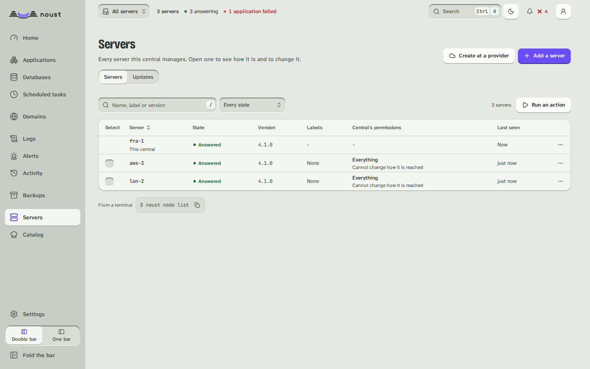

# Add servers to a central

Part of [The Noust central](CENTRAL.md).

## Adding a server

The central never keeps a credential of yours and never gets a shell on a server. You authorize
it **on the server**, where you are already root (below); or, when you only have an address and a
way in, the central does the same three steps once, from [a guided enrollment](#enrolling-a-server-with-an-address-and-a-credential).
Manually:

1. On the central: `docker exec -it noust noust node key vps1` (or **Fleet > Servers >
   Add a server** in the console). It prints the central's key for `vps1` and a command.
2. On `vps1`, as root, run the printed command:

   ```bash
   noust fleet authorize --central-key 'ssh-ed25519 AAAA... noust-central@nas' --name nas
   ```

   It shows each step as it runs, then:

   - keeps `vps1`'s console on `127.0.0.1` as a service. A console you started in the
     background (`noust web start -d`) is moved to the service on the same port, after asking
     (`--yes` accepts); if the service does not come up, the background console is started
     again as it was. **Your console's access token keeps working**: `authorize` issues one
     only when the server never had one, and then prints it once, after the join code;
   - creates `noust-tunnel` and its sshd block, and installs the key for it;
   - creates a `fleet` token and prints a **join code** on one line.

   Options: `--access read|deploy|admin` and `--allow-host-access` set the ceiling
   ([How far a central may go](fleet-model.md#how-far-a-central-may-go-on-a-server));
   `--ssh-user root --i-understand` installs the key for root as 3.0 did, with a warning.
   Run by mistake on the central that issued the key (the key names it, or it holds that
   very key), `authorize` refuses and says so.
3. Back on the central, paste the join code:

   ```bash
   docker exec -it noust noust node add vps1 --ssh vps1.example.com --join-code -
   ```

   The account comes from the code. The central pins `vps1`'s host key from it, opens the
   tunnel, checks the token and reads the server's ceiling. From then on a changed host key
   cuts the tunnel instead of being accepted.

### Enrolling a server with an address and a credential

```bash
noust fleet enroll vps1 --host 203.0.113.9                      # asks for the password, without echo
noust fleet enroll vps1 --host 203.0.113.9 --key-file ~/.ssh/id_ed25519 --ask-passphrase
noust fleet enroll vps1 --host vps1.example.com --port 2222 --access deploy \
    --host-key-fingerprint SHA256:...                          # for a script (password on stdin)
```

Over the API it is `POST /api/fleet/enroll/host-key` (asks the address which host key
answers) and `POST /api/fleet/enroll` (a job whose log streams what happens on the server, the
installer's output included; it asks for sudo mode and `fleet.manage`); the console has no
dialog for it yet. What it does, in order, and what makes it the manual join:

1. **The host key is confirmed first.** The central shows the ed25519 fingerprint that answers
   and you compare it with the server's own (`ssh-keygen -lf /etc/ssh/ssh_host_ed25519_key.pub`,
   or your provider's console). It connects with that key and no other (`StrictHostKeyChecking=yes`
   against a file holding only it), and the join code the server prints later must carry the same
   one, or nothing is registered.
2. **Noust is installed if it is missing.** The central sends *its own copy* of `install.sh`
   (the deb and rpm packages and the container carry it in `/usr/share/noust/`) over the
   connection and runs it as root with `--yes --no-console`; the server downloads no script.
   A central installed with pip has none: install Noust on the server by hand, then enroll it.
   `--no-install` refuses instead of installing. A Noust older than 3.1 is not touched.
3. **`noust fleet authorize` runs on the server**, with this central's key for it and the ceiling
   you chose (`--access read|deploy|admin`, `--allow-host-access`): the `noust-tunnel` account, the
   restricted key, the sshd block, the token. The console on that server becomes a service on
   loopback if it was not; its own access token, when authorize had to issue one, is **not**
   kept (`noust web token --new` on the server issues another).
4. **The central joins it** as `noust node add` does: it pins the host key, stores the token,
   opens the tunnel and asks the server who it is. When any step after authorize fails, the
   authorization is withdrawn (`noust fleet deauthorize`), so nothing is left half-done.

The credential is a password or a private key (with its passphrase, if it has one), used for these
few connections and kept nowhere: not in an argument list, a log line, a job's result, the audit
trail, an approval's record or a file that outlives the call. A password or a passphrase reaches ssh
through its environment and a helper script that holds no secret; a key is written to a file in a
private, memory-backed directory (`$XDG_RUNTIME_DIR`, `/run/noust` or `/dev/shm`) that is removed on
every way out. The account may be `root`, or one with passwordless `sudo` (`sudo -n`). When a
second person must approve adding servers, the approval is for everything but the credential: its
fingerprint is the call without it. Needs two-factor sign-in on this central, as `noust node add`
does; `--replace-token` lets a server that already holds a token for this central issue a new one.

### Creating a server at a cloud provider

A central can also make the machine: Hetzner Cloud, DigitalOcean and Vultr. You give it an API
token once, pick where, what size and what it starts from, and it creates the server, waits for
it, installs Noust on it and adds it to the fleet, with the log of every step streaming.

```bash
noust fleet cloud account add hetzner-prod --provider hetzner --note "production project"   # asks for the token, without echo
noust fleet cloud catalog hetzner-prod                          # locations, sizes with their monthly price, images
noust fleet cloud server create web-7 --account hetzner-prod --location fsn1 --plan cx22 \
    --image ubuntu-24.04 --script swap-2g --script unattended-security-updates
noust fleet cloud server list                                   # what this central created, and why one did not join
noust fleet cloud server delete web-7 --remove-node        # asks for the name, then destroys the machine
```

In the console it is **Settings > Cloud providers** (the accounts, the servers created here and the boot
scripts) and **Fleet > Servers > Create at a provider**, a wizard in five steps that ends on the
job's log. Everything that spends or destroys asks for sudo mode, and a second person's approval
when your policy requires it.

- **The token is a secret of this central.** It is read without echo (or from standard input),
  never from an argument, checked with the provider before it is kept, stored in the secret store
  (sealed with the rest on a sealed central) and shown afterwards only by its last four characters.
  A provider that answers 429 is waited for; a request that creates something is never repeated
  after a network error, so a server is never made twice.
- **Nothing secret travels in the new machine's boot data**, which every local user of the machine
  can read from the provider's metadata service. The central chooses the server's SSH host key
  before the machine exists and sends it in the cloud-init document, so it pins the key it chose and
  never trusts whatever answers; it logs in once with a key pair it generates for this machine
  alone, kept only in memory and uploaded to the provider as a one-time SSH key, and then joins the
  server exactly as `noust fleet enroll` does. The one-time key is taken out of the server's
  `authorized_keys` and deleted at the provider when the server has joined. If the server does not
  join, it stays on record with the reason (billed until you delete it), unless
  `--delete-on-failure` says to delete it.
- **The boot scripts are a library** (`noust fleet cloud script`, Settings > Cloud providers): shell scripts
  and `#cloud-config` fragments the new server runs as root on its first boot, after Noust's own
  part. Noust's part (the SSH host key, who may log in, no password logins) cannot be overridden by
  a fragment, a script must say what runs it (`#!`), and anything that looks like a credential is
  refused. `noust fleet cloud script preview` shows the whole document a server would boot with.
  Three come with Noust: `swap-2g`, `base-packages` and `unattended-security-updates`.
- **Firewalls, networks, SSH keys and backups** of the provider's own can be chosen where the
  provider has them; the catalog says which. Noust installs on Debian 12 and 13 and Ubuntu 22.04,
  24.04 and 26.04, on x86-64 and arm64; the sizes are listed with their processor, and only the
  images that run on it.

A server you made yourself at the provider's console can be given the same standing afterwards:

```bash
noust fleet cloud server link web-2 --account hetzner-prod --id 4711   # asks the provider; changes nothing there
noust fleet cloud server unlink web-2                                  # forget it; neither the machine nor the server is touched
```

The provider is asked whether the machine exists and is at the address the server is reached on
(`--force` links it anyway, for a server that answers elsewhere). From then on `server show web-2
--live` says whether it is on, `power-on` starts it, and `delete` can destroy it, as for one this
central created. Linking and unlinking ask for sudo mode.

**Fleet > Servers** lists every server the same way, with its reachability, version and
when it was last seen, and starts the same add flow (step 1 above) without the CLI:



To take a server out: `noust node remove vps1` on the central, or revoke the central from the
server itself (`noust fleet deauthorize --name nas` removes its key lines, from the tunnel
account's file and from root's, and revokes its tokens). The `noust-tunnel` account and its
sshd block stay for the next central; with no key left in its file, nothing can log in as it.

## A server behind a bastion

A server in a private network is reached through a host that has an address the central can reach: a
bastion. The central asks the bastion for **one stream to the server's sshd** and speaks SSH to the
server through it, so the server's own host key is still pinned and checked end to end, and the
bastion carries bytes it cannot read or change. It is a hop, not a trust.

```bash
noust node ssh web-5 --bastion hop@bastion.example.com:22 \
    --bastion-fingerprint SHA256:... --show               # the line the bastion's operator adds; changes nothing
noust node ssh web-5 --bastion hop@bastion.example.com:22 \
    --bastion-fingerprint SHA256:...                      # then set it, once the bastion lets the central in
noust node ssh web-5 --show                               # the line of the bastion in force
noust node ssh web-5 --timeout 30                         # wait longer for a slow link (1 to 300 seconds)
noust node ssh web-5 --no-bastion                         # direct again
noust node add web-5 --ssh noust-tunnel@10.0.0.5 --join-code - \
    --bastion hop@bastion.example.com --bastion-host-key 'ssh-ed25519 AAAA...'
```

In the console it is **Fleet > Servers > the server's menu > Connection options**
(`GET` and `PUT /api/nodes/{node}/ssh`; the line a new bastion needs is asked for first with
`POST /api/nodes/{node}/ssh/authorization`, as `--show` does).

- **The bastion's host key is given, never learnt.** A new bastion needs `--bastion-fingerprint`
  (`SHA256:...` as `ssh-keygen -lf` prints it, checked against what the bastion answers) or
  `--bastion-host-key`; with neither, nothing is changed. It is pinned in the central's own files, and a
  change closes the tunnel and says so, as for a server.
- **The change is tried before it is kept.** With the new options the central opens the tunnel and checks
  the server answers; when it does not, the old options are put back (`--no-test` keeps them without
  trying, for a server that is down now). A bastion that does not let the central in yet fails that
  test, which is why the line is asked for first, with `--show` and the `--bastion` you mean to set.
- **The central gets no shell on the bastion either.** `node ssh --show` prints an `authorized_keys`
  line for the account the central logs in as there, with `restrict` and a `permitopen` for this one
  server: one stream to it, no terminal, no command, no other destination. It uses the key the central
  already holds for that server.
- **The wait for the connection is the server's own** (10 seconds by default): a LAN answers in one, a
  satellite link or a slow VPN in thirty.

## Servers behind NAT or a CGNAT

A server in a house or on a carrier's CGNAT has no SSH port the central can reach. It reaches the
central instead: it keeps one SSH connection to it open (`ssh -R`) and the central talks to its
console through the loopback port that connection leaves, with the same fleet token, from
loopback, as it does through a tunnel it opens itself. **Nothing about the model changes**: the
central never gets a shell on the server, and the server gets none on the central.

What the central needs is an SSH server that the servers can reach: a central on a VPS, or a central
on the host of a NAS with its SSH port forwarded. A central in a container has no sshd of its own,
and `noust node link setup` says so. Prepare it once, as root, on the machine whose sshd the
servers will dial:

```bash
noust node link setup                  # the account noust-link and its restrictions in sshd
noust node link status                 # ready? which servers dial in?
```

`noust-link` is an account with no home, `nologin` as its shell and a password nothing matches,
restricted in sshd itself (a Noust `Match User noust-link` block, validated with `sshd -t` and
checked with `sshd -T`, and put back if sshd applies something else): it may open a remote
forward of one loopback port and nothing else. No command, no terminal, no local forward, no
Unix socket, no agent. Each server's key is further limited to the one port that is its own
(`permitlisten="127.0.0.1:24001"`), so one server cannot take another's.

Then, for each server:

```bash
noust node link invite web-5 --host nas.example.com        # on the central: the address web-5 dials
# on web-5, as root: the command it printed
noust fleet link --name nas --as web-5 --host nas.example.com --ssh-port 22 \
    --host-key 'ssh-ed25519 AAAA...' --remote-port 24001 --invite 3f9c...
noust node link add web-5 --link-code -                    # on the central: paste what web-5 printed
```

- The command carries **the central's SSH host key, which the server pins**: it never trusts
  whatever answers the first connection. Compare the fingerprint the invitation shows with
  `ssh-keygen -lf /etc/ssh/ssh_host_ed25519_key.pub` on the central.
- `noust fleet link` runs `noust-link-<central>.service`, restarted whenever the connection ends
  however long the central was out of reach. It issues the fleet token (`fleet-<central>`) and
  prints a **link code**, which holds that token and the public half of the key it dials in with,
  and which the central checks against the invitation: another server's, another central's or an
  expired (24 hours) code is refused. `--access read|deploy|admin` and `--allow-host-access` set the
  ceiling, as for any server.
- `noust node link add` installs the server's key, waits for the connection (30 seconds) and checks
  the token, and keeps nothing unless the server answers; if it does not connect, the key is taken
  out again and **the same code can be pasted again**. Needs two-factor sign-in, as every way of
  adding a server does, and asks a second person when your policy says so.
- **The central sends the token only to the link account's own listener.** The port is fixed, so a
  local account that took it while the link was down would otherwise receive the token. The central
  reads who owns the listener from the kernel and refuses a port held by anyone but `noust-link`
  or root: nothing is sent, and the message names the port.
- Ports 24000 to 24999 of the central's loopback are the links' (`--port` chooses another);
  `noust node link cancel NAME` gives back an invitation nobody answered. The console does it all:
  **Fleet > Servers > Add a server**, then "It cannot be reached from outside".
- A server that dials in has no SSH key of the central's to rotate (`noust node rekey` says so).
  To take it out: `noust node remove web-5` on the central, which takes its key out and forgets its
  port, and `noust fleet unlink --name nas` on the server, which stops the service, removes its key
  and revokes its tokens.

## Moving a server to another central

A server is not owned by a central: it trusts one because its own operator ran `noust fleet authorize`
there, and it can trust two at once. Moving it is three steps in this order, and the third carries over
what the first central had recorded about it:

```bash
noust node export web-5 -o web-5.inventory.json          # on the old central
# on web-5, as root: noust fleet authorize --central-key '<the new central's key>' --name new-central
noust node add web-5 --ssh web5.example.com --join-code - --inventory web-5.inventory.json   # on the new one
noust node remove web-5                                   # on the old one, when the new one works
```

The inventory is the server's labels, the applications placed on it, the machine it is at a provider,
whether its monitoring is paused and, only with `--include-ssh`, how the old central reached it (its wait
and its bastion: a path that worked from one central may not exist from the other). **It holds no
secret**: not the server's fleet token, not the old central's key for it, not a cloud account's API
token, which never leave their central. A file is checked whole before anything is written, and what
cannot be applied (a cloud account the new central lacks, a label it would refuse) is reported with the
reason. For a server already added, `noust node inventory web-5 web-5.inventory.json` applies a file
later. In the console: the server's menu in **Fleet > Servers** (**Export its inventory**, **Apply an
inventory**).

## Moving a 3.0 server to the tunnel account

Upgrade Noust on the server to 3.1.1 first (3.1.0 does not know `--replace-root-key`), then:

```bash
noust node migrate-tunnel vps1              # on the central: the command for vps1
# on vps1, as root: the printed 'noust fleet authorize ... --replace-root-key ...'
noust node migrate-tunnel vps1 --join-code -   # on the central: paste the new code
```

On `vps1`, `authorize` creates `noust-tunnel`, installs the same key for it and takes that
key out of root's `authorized_keys`, then issues a new token (revoking the old one). The key is
matched by the key itself (`--replace-root-key`), not by the central's name in the line's
comment: a 3.0 line can name the central otherwise (`noust-central:example`), and 3.1.0,
which matched by name, left such lines in root's file. Every other line is kept, and a copy of
the file as it was is left next to it (`authorized_keys.noust-<UTC time>`, mode 0600).
`authorize` reports the file under "Old line removed from" (`moved_from` in `--json`) and the
copy under "Copy of it before" (`root_key_backup`).

The central switches to the new account once `vps1` answers as it, and puts back what it had if
it does not; the code can be pasted again. After that the server no longer needs
`PermitRootLogin` for the fleet.

Whatever its options, `authorize` then warns about every line still in root's
`authorized_keys` that carries Noust's tunnel options (`restrict,port-forwarding,permitopen=...`),
and so does the hardening check "A central's tunnel logs in as root" (`noust server security
checks`, counted by `noust health`). Each warning gives the exact command that removes that key
and nothing else:

```bash
sed -i '\#AAAAC3NzaC1lZDI1NTE5AAAA...#d' /root/.ssh/authorized_keys
```

A server migrated with 3.1.0 still has that line: remove it with the command the warning prints,
once `noust node list` on the central shows the server reached as `noust-tunnel`.
