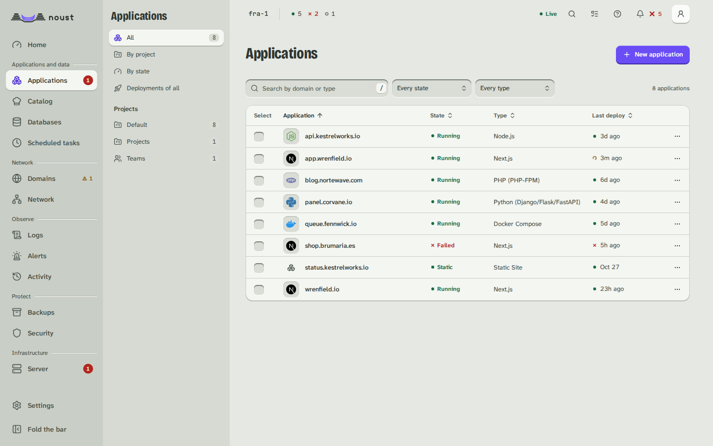
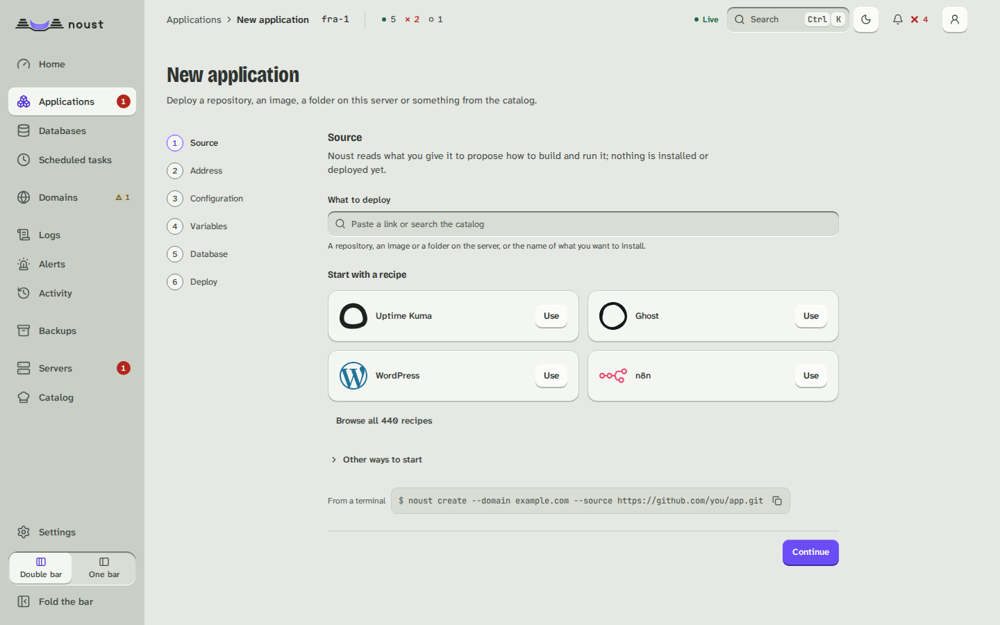
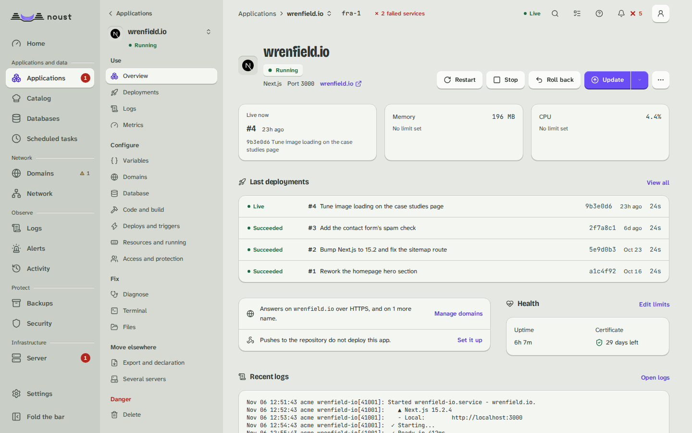
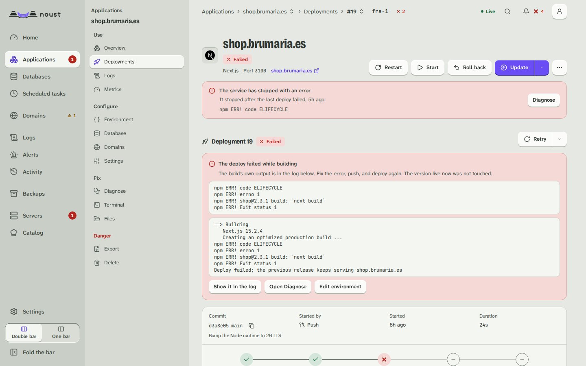
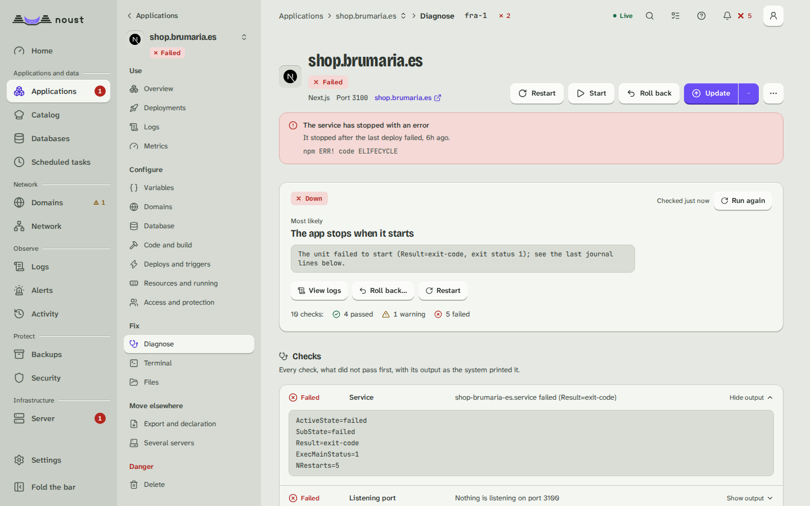

# Applications: the list, recipes and each application

Part of [The console, page by page](console.md).

## Applications

Every application with its state, type, port, last deploy, CPU and memory, filterable by
state, type and, once any app carries one, **tag**. Narrowed to one tag, the page offers **Update
tagged apps**: each app that carries it pulls its source and builds a new release, as Update does,
and one with nothing new is skipped unless you tick **Rebuild even when there is nothing new**. A
row's menu also has **Promote to another environment** (the release that serves goes to the same app
in another environment of its project, without being built again) and **Clone application** (a new
app with this one's settings and a domain you give it, in this or another environment; when the app
has a database you choose between one of its own and sharing it). See [teams.md](teams.md).

On a phone, rows become cards with their actions always visible.

Each row has a checkbox. With some chosen, **Act on N selected** opens the plan of an action
(restart, update, stop or start): what will be done to each application, and which are left out and
why (a static site has no process to restart, an application already stopped is not stopped again,
one being deployed is not restarted). **Restart N applications** then does it one application at a
time, in the order chosen, with the server's own words for any that fails and **Retry the failed**
for those alone. Each is the call the application's page makes, so sudo mode, the audit trail and
the update queue are the same.

**New application** (`/apps/new`) asks for what it needs and nothing else. In **Source** you give a
Git URL, a path on the server or a Docker image, or choose **From GitHub**; what you give is read at
once, and a line under the field says what was found, with **Change**: the detected type (editable),
the commands, the port and the variables declared in `.env.example` as a form, with secrets flagged
(`Detected: Next.js with npm. Port 3000. 2 variables to fill in.`). **More ways** are Compose, a
recipe, an import (an export file, or an application read from a Coolify or Dokploy server with a
read-only token) and a site that already runs. Then **Address** (a name of your own, whose DNS the
console checks, or, on a server with a public address, a temporary one such as
`shop.203-0-113-10.sslip.io`, which needs none), **Configuration**, **Variables**, **Database**
(optional: one created and linked before the first build, its connection string in the app's
environment) and **Deploy**. The stepper lists only the steps that ask something, and the summary
before deploying says what was detected, the address and the variables, each with **Change**. The
deploy streams the build log until the application answers, and ends on one card: the address with
copy and open, whether HTTPS is ready, and what to do next. On a fleet there is also a **Server** step,
or switch to the server first. A repository the console cannot clone shows git's own words and this
server's public key, to add at the code host. Leaving with something chosen asks first.

The Source step also offers **A running stack**, for a Docker Compose stack that already runs on
this server and that Noust did not deploy (one started by its own `deploy.sh`, say). You give the
domain it serves and the directory it runs from, and under **More options** its compose file, the
site file that serves the domain, the repository updates fetch from and the branch. **Preview**
reads the project from the running containers' labels, finds the site, and shows the output of
`docker compose up --dry-run` verbatim: it must say nothing would be recreated. **Adopt** then
registers the stack without cloning, cleaning, rebuilding or restarting anything, and installs its
service without starting it. If the rehearsal lists changes, the adoption is refused with
Compose's own output, unless you tick **Adopt anyway, recreating what Compose lists** after reading
it. Adopting needs sudo mode. See [compose.md](compose-adopt.md#adopting-a-running-stack).

Besides a repository, the Source step offers **A Docker image**: an image from a registry runs as
a container application, with nothing to inspect (and no source: the server refuses one given
with it). A repository with only a Dockerfile is proposed as a container application too, and
Configuration then asks how its image is made: a Dockerfile (its path, the context, the stage,
build arguments and build secrets) or Railpack, the port the process listens on, its volumes, how it
restarts and, for an image, a private registry's account. A build secret's value and a registry
password are typed into masked fields, sent once and never shown again; the last step names how the
image is made and never a secret. A container's releases are images, so the layout and the folders
kept in `shared/` are not offered, and neither is a database: it cannot reach the host's. See
[containers.md](containers.md).

## Recipes

The recipes this release ships (`noust recipe list`), reached from **Applications** and kept at
`/catalog` (so are the installed ones, `/catalog/installed`), each as a tile with a **Popular** row
before any filter: its logo (an image the server
serves, within the strict policy), name and slogan, its category from a closed list, tags, the
version it pins, the day the recipe last changed, links to its site and documentation, **Runs in
Docker** for a Compose recipe and what a native one needs (a database Noust sets up, a PHP-FPM). A
recipe this release cannot deploy is listed with the server's reason and no button. Search and the
category, tag and **Runs** (in Docker or natively) filters are the server's own search, kept in the
address; the list pages at 20, 50, 100 or all recipes. **Use** opens the wizard on that recipe's
one step: where it answers and the variables it cannot run without, each with what it is for and
the default an empty field keeps (a secret is masked), and Deploy waits for the required ones and
leads to the field. **Details** opens the recipe's own page: what it runs (image, tag and digest),
what it needs, every variable and where its value comes from, the ports it opens on purpose, what it
will tell you after the install and what each version changed. The install is a job, its output a
click away while it prints.

A recipe's page also lists what installing it needs from this server (memory, disk, the ports it
opens, the runtime and the database engines), each met or missing, and the wizard shows the same before
anything is made and asks whether to back the new application up every day. **Add a recipe** checks a
recipe you paste against the catalog's schema and its lint and keeps it on this server, apart from the
ones Noust ships; a recipe of yours says so on its card. **Catalog package** shows the signed package that
grows the catalog between releases (who signed it, its serial, what is in it) and fetches or removes it.
The new-application wizard also takes **Compose**: it is read first, without running anything,
and what refuses it or is worth knowing is shown before it is deployed. See [recipes.md](recipes.md).

**Installed** lists what was installed from a recipe, the version it runs against the catalog's
and what changed. **Update** is the one update (a copy first, the startup check, the previous version
back when it fails) queued as a job; a variable the new version asks for and the application lacks is
asked for, the ones it has keep their value. An application whose recipe left the catalog says so,
in the server's words. See [recipes.md](recipes.md).

## One application

The header shows the domain, state, type, port and a link to the live site. A banner between the
header and the tabs appears while a job runs on it, when its last deploy failed or when it is
down, with a link to **Diagnose**. Tabs:

| Tab | What it has |
|---|---|
| Overview | What is live now and what changed, the last deployments (a failed one says which version kept serving), the application's health (uptime, certificate, CPU and memory, with the way to change its limits), its previews, and where it answers and whether a push deploys it |
| Deployments | The application's [queue](#the-deploy-queue-and-cancelling) when something builds or waits for it; the deployment history in one list: what serves is marked **Live**, a failed deploy says which version kept serving, a deploy that was cancelled is drawn as **Cancelled** and never as a failure, search and filters (state, branch, who started it) are in the address, and each row opens its page or acts from its menu (**View log**, **Roll back to this**, **Retry**, **Rebuild this commit**, **Copy commit**); a build made with **Build without serving** waits at the top with **Go live**; an application kept in a single folder lists its backups under the list |
| Logs | The unit's journal, live; for a Docker Compose stack or a container application, what the containers printed (all services or one, read again every few seconds), with the unit's journal as one choice |
| Metrics | CPU and memory (requests and errors for a static site) over an hour, a day, a week or a month, against its limits, with deploys marked; or why there is nothing to show. A Compose stack of two containers or more adds CPU, memory, disk and network **by container** (the busiest three of each), and a site whose access log is read adds **who asks for what**: requests and errors by the hour, data served, and the pages, networks, status codes and referrers that appear most |
| Environment | The `.env`, redacted; revealing a secret needs sudo mode. A row opens on press, and a hidden value is never read to be edited: it is kept, or replaced (**Replace value**). A change shows in its row, the old value struck beside the new one, and the bar at the foot writes only what changed: **Save and restart**, or **Save only** from its menu, which leaves the change waiting as "not applied". A pasted file, or more than six changes, is looked over in full first. A value made of references (`{{project.NAME}}`, `{{secret:vault/...}}`) is shown as written, not as what it resolved to, and **Resolve references** reads them again without a deploy. **Given to** (build and runtime, build only, runtime only) is in each row's menu and in the add dialog, and saved with the values. **Given by Noust** lists `NOUST_URL`, `NOUST_BRANCH` and the rest, read-only. See [variables.md](variables.md) |
| Database | The databases it uses, creating and linking one, and its connection string |
| Domains | Primary, aliases and redirects, with a DNS check per name; add a name as an alias or a redirect (Docker Compose stacks that publish a port and monorepos included; see [domains.md](domains.md)) |
| Settings | One page per subsection, below |

**Changes not applied yet.** When an application has been set to something it does not run
with yet (a variable, a limit, a command, the sandbox, a mounted file), a chip on the header's
state line says how many (**2 not applied**), and the Environment tab counts its own. The chip
lists each change by area with what it needs, a restart, a build or the next deploy; the values
of secret settings are never shown, only that they changed, and **Restart now** (or **Build
again now**) applies them when that is all they need. **Deploys paused** and **Deploys frozen**
are said the same way, and lead to where they are resumed.

**Update** is a split button: its arrow holds **Update without cache** and, on an application
with instant rollback, **Build without serving**. **Roll back** is one question wherever it is
asked from (the header, a row of the history, a deployment's page, Diagnose): which version,
what goes back, what stays as it is, and whether automatic deploys will pause.
See [runtime.md](runtime.md#changes-not-applied-yet).

**Files** is in **More actions**, for whoever may open a terminal: the application's files a
folder at a time (the folder is in the address), as the account the application runs as, with
edit, upload, download, new folder, rename and delete. Environment files are the Environment's
and are not opened here. See [runtime.md](runtime.md#files).

Each deployment has its own page: commit, trigger, duration, a phase timeline, the build log
(live while it runs, with "Show the whole log" when it was truncated, and filters by level and
text, a switch for the times, and **Copy to share**, which masks anything that looks like a
credential), and on failure a link
to Diagnose plus Roll back and Redeploy.

A deployment that ran [deploy hooks](releases-hooks.md#hooks-and-schema-aware-rollback) lists them
under **Deploy hooks**, in the order they ran, before the new version served and after it did.
Each shows how it ended (succeeded, exited with a code, ran out of time, did not run), how long it
took, the service it ran in on a Compose stack, and the end of its output verbatim; Prisma's
automatic migration is listed the same way. The section also says whether the deploy changed the
database schema, and the list of deployments marks such a deploy with a **Database changed**
badge. When a hook that runs after serving failed, the page says **Deployed with warnings**: the
new version serves, nothing was undone, and the hook's output is shown (the `deploy_hook_failed`
notification says the same).

With instant rollback, rolling back switches `current` and restarts behind the health gate in
seconds, and is not a job. On an application in a single folder (in place), rolling back
restores a backup and runs as a job. See [releases.md](releases.md).

**Going back past a change to the database.** Noust puts code back, never a database. When later
deployments changed the schema, every way back asks first: rolling back to a deployment,
activating a release, the Roll back dialog's backups, and restoring a backup's files. Before you
press the button, the deployment's dialog says which deployments changed the schema after it. If
you go ahead, **Going back passes a change to the database** lists those deployments with the
migrations each one ran, names the backup taken before the first of them and the
`noust backup restore` command that puts the database back (for a Compose stack,
`--databases-only`), and **Go back anyway** repeats the request confirmed. A failed health gate
still puts back what served before, whatever the attempt changed. See
[releases.md](releases-hooks.md#hooks-and-schema-aware-rollback).

**Settings** has a side navigation, a URL per subsection, and a save bar ("N unsaved changes ·
Discard · Save"):

| Subsection | What it has |
|---|---|
| General | Type, port, source, **App tags** (the labels that group it, edited from here), the branch it deploys from (pin or unpin it), the tags it deploys (**Follow tags...**: a pattern such as `v*`; see [compose.md](compose.md#deploying-by-tag)), commands, how deploys work, the service and the account it runs as (**Give it its own account...**: its service, files and `.env` move to an account of its own and the app restarts once; if it does not answer afterwards everything is put back exactly as it was). On a Compose stack that publishes no port but still has one recorded, **A worker reported as down** offers **Record it as a worker...**, which clears the port and judges the stack by its containers |
| Source | How the server signs in to the repository: its **deploy key** (an SSH key for that repository alone, made on a click or imported, its public half shown to add at the code host with a copy button and a link to the host's page, **Test the connection** as a deploy would, **Replace the key** without a moment when the repository has none that works, and **Remove**) and, for a repository cloned over https, an **HTTPS credential** (a user and a token kept as a secret, never shown again). Writing a secret asks for sudo mode first. See [api.md](api.md#deploy-keys) |
| Container | A container application only: how its image is made (a Dockerfile, Railpack or a registry image), the Dockerfile, context and stage, build arguments, build secrets (their ids, never their values; one can be removed), the port, the volumes, the restart policy the registry account of the image itself (its password is write-only: it is never shown and an empty field keeps it) and the **registry accounts** it pulls with, chosen among the ones Settings > Integrations holds. A change is stored at once and takes effect with the next update |
| Build | The install, build and start commands, the base directory, the publish directory and the runtime of a type that has a build block (not a Compose stack, a monorepo or a container), where they come from (this application's own settings, the repository's `noust.yaml` or the type) and that the application's own settings win whole; saving asks for sudo mode, and the application's own settings can be removed. Below them, the **System packages** the host needs (edited in a drawer, installed with a button), the **Build cache** and the **Process types**; and the **Build sandbox** card: whether it builds in the sandbox or as root and why, **Test a sandboxed build**, then turn it on (the trial Noust runs by itself before the next update of an app that still builds as root is recorded here like one you ran), the network profile, and building as root with a reason. A Compose stack or a container shows the sandbox and says why it has no commands here. See [build.md](build.md) |
| Releases and rollback | **Instant rollback**: what it gives you, what changes on disk, the migration plan and a rehearsal, then the migration; releases kept; the **startup check**; and **Zero-downtime deploys** (blue/green, which new applications that can run as two copies start with by default; on a Docker Compose stack, the relay, which says what to change first when the stack or its site cannot use it). Instant rollback and zero-downtime deploys say whether they are on in the header of their card |
| Automation | What deploys the app without a person asking and what holds, plans and protects its updates, as rows with no save bar: **Automatic deploys** (a switch; turning it off pauses what a push, a tag or a schedule deploys, with a reason, and a second switch decides whether a rollback pauses by itself), whether an update is refused when its **backup** fails, on a Compose stack the **copy of the databases before an update**, **Freeze deploys** for an application, **Scheduled updates** (when it updates itself, with its backup first, and how the last run ended; set in a drawer) and the **deploy limits** (how many deploys are kept, the time and the signal a unit stops with; also a drawer). A freeze or a pause is also said on the Deployments tab. See [delivery.md](delivery.md) |
| Compose | A Docker Compose stack only: its options, the networks it joins and the **registry accounts** it pulls and builds with, saved together from one save bar. See [compose.md](compose.md) |
| Deploy on push | The webhook as a guided setup for GitHub, GitLab, Gitea and Bitbucket Cloud, in three steps (the public address, the secret, what to enter at the forge) of which the one the setup is at is open and the ones done can be read again: the public URL (`noust web expose-hooks`, or the console's own address on a network the forge shares), the secret, the values to enter at the forge, the branch that deploys, and the last pushes received, ignored ones included. When this server's GitHub App already reaches the repository the first step says no webhook is needed. An app that follows tags says so here: releases and tags that match deploy, pushes to a branch do not, and a delivery for an older or unmatched tag is listed as ignored |
| Deploy hooks | The commands each deploy runs before the new version serves and after it does, where they come from (**From the repository**: the `noust.yaml` of the running code; or **From the operator**, which replaces it whole), each with its service, directory, time limit and whether it changes the schema. The operator's hooks are written here as YAML in the shape of a `noust.yaml`; saving asks for sudo mode and may wait for a second person's approval. An invalid `noust.yaml` is shown with the reason, and the next deploy fails with it until it is fixed or replaced by the operator's hooks. A static site has no hooks |
| Resources | Memory (MB, at least 64), CPU (percent of one core) and tasks (at least 16), optionally restarting so they apply now |
| Processes | The copies of the web process (each new one answers the startup check before it takes traffic) and the processes that run beside it (workers, schedulers): add, change, scale and remove. See [runtime.md](runtime.md#processes) |
| Service security | The systemd sandbox of the service (`off`, `default`, `strict`), the folders it may write to, how exposed systemd finds it, applied behind the health gate. See [runtime.md](runtime.md#service-security) |
| Mounts | Configuration files kept for the application and linked into every release (their text is editable here, and needs the permission that reveals secrets), and server folders bound into a container application. See [runtime.md](runtime.md#mounted-files-and-paths) |
| Previews | Pull request previews and their settings: where they answer, how many and for how long, **which variables a preview is given** (only the ones you choose, the default, or all of the app's) and **which data** (a database of its own, the default, or the app's), each choice that exposes something with one line saying what. Each preview has its **Logs** (the last build and the service), **Update**, **Stop** or **Start**, and **Remove**; **New preview** makes one from an open pull request (when the GitHub App reaches the repository), a branch or a tag; the variables defined for previews alone are listed below them. A Docker Compose application has previews too. The settings also give **how a preview is named** (a template, with the name it gives drawn beside it), whether to **keep search engines out**, what to do with **pull requests from forks** (refuse them, or wait for your approval of each commit, which shows on the preview as **Approve** and **Reject**) and a **copy of the database** as a third choice of data. See [previews.md](previews.md) |
| Access | Who may open the site: a password, named users, the addresses allowed, a private network only, how the visitor's address is read, a sign-in service in front of the site, and the behaviour of a prefix of the site. Saved, tested by the web server and reloaded together |
| Protection | What the site limits and sends back: request rate, response headers, HTTP/3, the web application firewall and client certificates. Saved, tested by the web server and reloaded together |
| Export | The application as a file to import elsewhere, and its declaration (`noust.yaml`): **Download the declaration**, or **Apply a declaration**, which can start from what runs now, shows the plan and then every block that differs line by line with a way to put a block back, and applies only what was checked. See [declarative.md](declarative.md#reviewing-a-set-of-changes) |
| Delete | Delete the application; removing its files and its certificate are separate choices, both off until you tick them, and you type its domain to confirm |

## The deploy queue and cancelling

Builds of different applications run side by side, up to the server's limit (`deploy.max_concurrent_builds`);
one application builds one thing at a time, so what is asked meanwhile waits its turn and nothing is lost
(see [releases.md](releases-deploys.md#the-deploy-queue)). The queue is on **Activity** when something builds or
waits, and on an application's **Deployments** tab for what is its own:

- every job is a row with its state (queued, in progress, stopping), its **place in line** ("Next in line",
  "Place 3 in line") and, for one that waits, **what it waits for** in the queue's own words, set in mono: the
  update of the same application that is running, a free build slot, a job that changes the whole server;
- a request for an update that is already waiting is **merged** into it (the last push wins, nothing builds
  twice): the row says "1 request merged into this one", and pressing **Update** says it joined the waiting
  one;
- the server's limits are in the panel's header ("1 of 2 builds running", "3 of 25 waiting"); a request the
  queue has no room for is refused, and the console says so with the seconds the server asked to wait
  ("Try again in 30 seconds, or cancel what no longer needs to wait"), and the server's own sentence under it;
- **Cancel** is on each row and on the job in hand under an application's header. A job that waits is taken
  out of the line, after one question. A deploy or an update that is building is **stopped**: the question says
  that the release it was making is removed, what serves now is not touched and the next request starts. Once
  its release starts to be activated, or when the application builds in the folder that serves (a single
  folder, a Compose stack), or for a job that is halfway through changing the system, the button is disabled
  and the reason is written beside it. A stop that was asked shows **Stopping** until the build has wound down.
  The same is `noust deploy cancel`.

A deploy that was cancelled is recorded as cancelled, with who cancelled it: the history, the deployment's page
and the overview never draw it as a failure and never raise it.

## Diagnose

Reached from the application's banner, or `/apps/<domain>/diagnose`. Correlates the unit's
state, the port it listens on, an HTTP probe straight to the application and one through nginx,
the last journal lines, nginx's error log for the domain, the certificate, the last deployment,
OOM kills in the last seven days and disk space. The most likely cause comes first, with each
check's evidence verbatim. Every probe only reads. The same report is `noust diagnose DOMAIN`. For an
application that restarts in place on every update and could update without a cut, it also says so, above the
checks, with a link to the setting that turns it on.
A Docker Compose stack that publishes no port (a worker) has no port or site to probe: it is
judged by its containers, and the evidence is their state and the last lines of `docker compose
logs`; when a port is still recorded for it, the report says so and names `noust app headless`.

## Terminal

Off the tab strip, under **More actions > Terminal** (`/apps/<domain>/terminal`): a shell as the
account the application runs as, in its sandbox and with its environment (a stack's, in its
container), and below it **Run a command once**, which splits what you type into the program and
its arguments, shows the list it will run, and shows the output as the job's log. The server's own
root shell is **Server > More actions > Open a terminal**, off until an administrator turns it
on. Both need sudo mode, are limited in time and recorded in the audit trail. The page is drawn on
a canvas, with a text view for screen readers; Escape, then Tab, leaves it with the keyboard. See
[Terminal and one-off commands](terminal.md).

## Cron

Scheduled tasks (Cron before 4.1), as systemd timers: create or edit one by choosing how often it
repeats (every hour, day, week or month, at the time you say, or a calendar expression of your own)
with a preview of the next runs, run it now, enable, disable, and see each task's recent runs with their
output and exit status. Under **More options** a task can be stopped if it runs longer than a limit you
choose and, for an application that is a Compose stack, run in a service of the stack (see
[compose.md](compose.md#scheduled-tasks-of-a-stack)).
