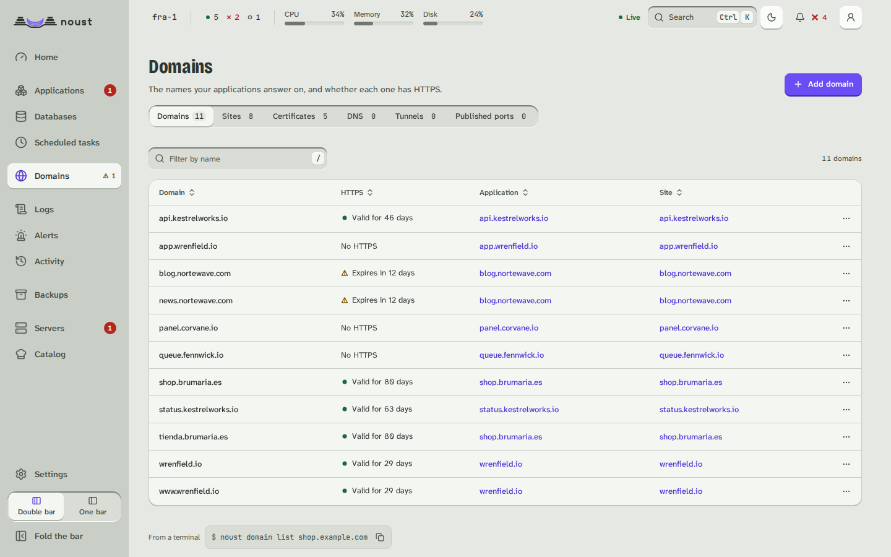

# Domains

Part of [The console, page by page](console.md).

Two tabs. **Certificates**: every certificate with its names, issuer and expiry; issue one
(method: automatic, nginx, Apache, webroot or standalone; extra names; `www`), renew those
due, renew one now, revoke, delete. **Sites**: every nginx or Apache site; create, enable,
disable, delete, and edit a site's configuration in a full-height editor with "Test" and "Test
and save": the web server tests it before it is installed.

The list shows every site file the web server has, the ones Noust wrote and the ones you wrote:
**Written by** says "Noust" or "By hand", and **Application** names the application whose site it
is, or says it is not an application's. A site written by hand is never rewritten by a deploy
(see [domains.md](domains.md#operator-sites)).

Three more tabs are shown to whoever may see the server: **DNS** (the accounts Noust holds at DNS
providers and the records it manages in them), **Tunnels** (Cloudflare Tunnels and the names each
carries) and **Ports** (the TCP and UDP ports nginx publishes). The Certificates tab can **upload**
a certificate and its key, opens the **certificate authority** settings and the **private authority**
(the server's own, for names that only resolve inside a network: made, trusted on this server, how to
trust it on each kind of device, the certificates it signed), from More actions; see
[certificates.md](certificates.md) and
[network.md](network.md). An application's **Domains** tab also chooses the spelling that is served
(`www` or the bare name), sends an alias to another port, shows and makes the DNS records of its
names, and chooses where its certificate comes from; its **Settings, Access** holds the password, the address lists, the private network,
the sign-in service and the routes of its site, and **Settings, Protection** the limits, the
response headers, HTTP/3, the firewall and the client certificates.

## A site as text, structure and diagram

A site's page (`/domains/sites/<site>`) shows its configuration in three views, chosen with the
**View** control and kept in the URL (`?view=structure`, `?view=diagram`; the Text view has none).
Only nginx and Apache sites have all three. The views share **one draft**, the text: what you
change in one appears in the others, the bar at the foot (changed lines, **Discard**, **Test**,
**Test and save**) is the same, and leaving the page with changes asks first. There is **one way
to save**: the same `PUT /api/sites/{domain}/config` whichever view made the change, which needs
sudo mode, may need a second person's approval, and tests the whole text with the web server before
it writes anything. A site whose text cannot be read (a draft with a syntax error) shows the
analyzer's own message with its line and column and a **Go to text** button, never half a
structure.

- **Text** is the editor, as before.
- **Structure** shows the site as what it is:
  - a card per `server`: where it listens as chips (`443 · TLS · HTTP/2`, with `default_server` where it is one), its names, its
    certificate with the days left, its maximum body size, and a note when it answers every
    request itself with a `return`;
  - the **locations in the order the web server tries them**, not the order of the file (exact
    matches first, then the longest prefix, regular expressions in file order unless a `^~` prefix
    stops them). Each has its kind of match, its path, and where it goes: an upstream (a chip that
    scrolls to that upstream's card), a proxied address, the files of a directory, a redirect,
    FastCGI. The settings used most are fields in the row (read timeout, maximum body size, rate
    limit, WebSocket, buffering), and **More directives** opens every other directive of the
    location as written, editable;
  - **Upstreams** with their servers, how many locations use each, and "Defined in ..., read only
    here" for one an included file declares; **Other directives** (maps, zones, anything the
    structure does not model) and **Included files**, as written: nothing is hidden;
  - the comments of the file as notes next to the element they belong to;
  - **Add location** (**Proxy**, **Static files** or **Redirect**), and from each location's menu
    **Duplicate**, **Move up in the file**, **Move down in the file** and **Remove**. Moving is only
    ever what you ask for: the structure never reorders the file to tidy it.

  A text field applies when you press Enter or leave it, not on every key, and Escape puts back
  what the file says. Each change is an operation sent to the backend
  (`POST /api/sites/{domain}/config/edit`), which changes only the bytes of the element concerned
  and keeps its indentation; the rest of the file stays identical, comments and blank lines
  included. The answer is the new draft, and the changed elements are marked **Changed**. Nothing
  is written to disk until **Test and save**.
- **Diagram** is read only. It draws how a request travels, in columns: **Ports**, **Names**,
  **Locations**, **Destinations** and **Backends**. Every element has a shape and a text label;
  colour only says whether a backend answers (responds, not responding, unknown), always with its
  glyph and word, and a backend says who holds its port: a Noust application, a service of a
  Compose project, a container, a systemd unit or another process. Dashes move along each
  connection in the direction of the traffic, faster where the connection is encrypted, and a
  WebSocket is drawn as a double line; with `prefers-reduced-motion` they stand still. Pointing at
  or focusing an element lights its whole path, and pressing it keeps it lit. Under the drawing
  are a written summary (how many connections, which elements do not respond) and the same
  connections as a table behind **Show the connections as a table**. On a phone each column is a
  list. Whether a backend answers is the result of a one-second connection to its loopback port,
  cached for ten seconds; a draft is drawn from the unsaved text but its backends' state comes from
  the saved file.
- **Try a URL**, above the diagram, takes a full address or a path
  (`https://shop.example.com/api/`) and asks the backend which server and location answer it
  (`POST /api/sites/{domain}/route`); nothing is requested, the web server's rules are replayed over
  the file (or the unsaved draft). Only that path is lit and animated, a sentence says which
  location of which server answers the URL (or that the server answers it itself because no
  location matches, or that no server takes it), and a numbered explanation gives each step of the
  web server's choice: which server by port and name, which location by exact match, longest
  prefix or regular expression, and what that location does. It is the way to see why
  `/api/v1/auth/login` reaches the location it reaches and not the one you expected.

A server whose Noust is older than 3.2 (a 3.1 node reached through a 3.2 central) has no such
views: the page says "This server runs an older Noust" and **Edit as text** goes back to the
editor, which works as before.
