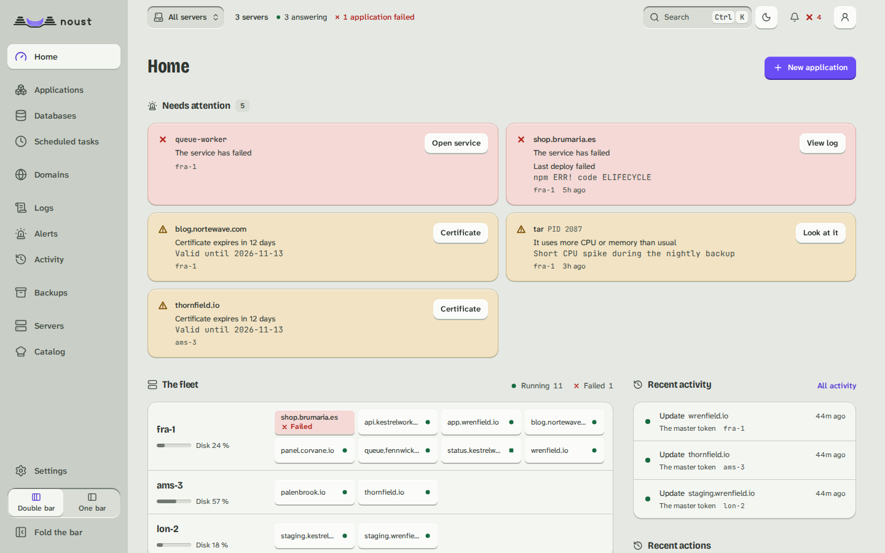
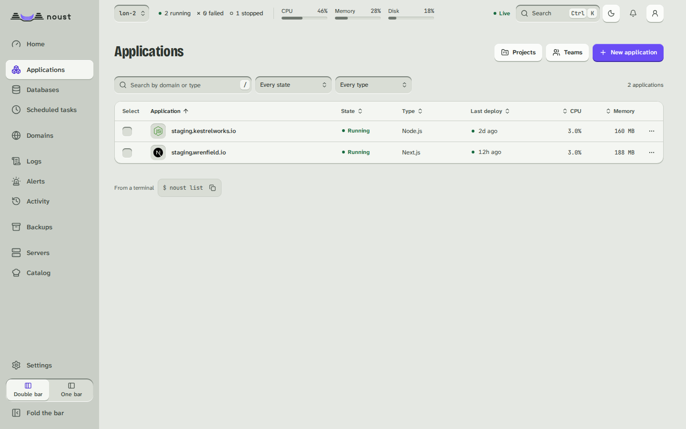

# Fleet

Part of [The console, page by page](console.md).

A [central's](CENTRAL.md) own pages, hidden on a plain server: choose **All servers** in the scope
selector and the sidebar lists them. **Overview** (the fleet's key figures and what needs attention
on every server, worst first), **Servers** (reachability, which Noust each runs, how loaded it is, what it
has waiting, labels, and the one button that updates it: **Update to 2.1.0**, the version the server's own
package source offers; **With an update**, in the column, is the same list kept to the servers that wait for
something), **Applications**, **Certificates**, **Backups** and **Activity**, each row with its
server and a link to its page there. In an area that belongs to one machine (Server, Security, Network), choosing
**All servers** gives the list of servers with that area's summary, and choosing a server opens its page. The
fleet's Overview ends with **Compare servers**: one measurement of every server (CPU, memory, swap, disk,
load, network) over the same window, the busiest first, from each server's own history; a server
that did not answer is a gap, said so. A server
that did not answer, is too old for a view, or refused you is one row with its state and its
own words; the rest of the page is unaffected.

**Bulk actions** (renew certificates, back up, verify backups, update or restart applications,
update Noust, apply system updates) are chosen from a list of servers or by label, show their
plan first (which servers, in which batches, what is skipped and why), and run as a fleet job
with each server's outcome and a button to retry the servers that failed. **Add a server**
is on **Servers**, and the selector and the palette lead to it.

On a fleet job's page, **Details** on a server's row opens what happened there:

- **A failure first**, with the server's own words verbatim and the suggested fix above them.
- **Its state**, how long it really took (or has been running), its batch, and what the job
  returned in words: for a system update, how many packages and which, whether a reboot is due
  (nothing is rebooted) and which services still run old libraries; for Noust's update, the version
  it went from and to; for a certificate renewal, each certificate renewed and its new expiry. A
  server older than 3.2 does not say which certificates, so nothing is guessed.
- **The job's log on that server**, in the log viewer (search, copy, download, follow the end):
  live while it runs, over the job WebSocket the central relays through the tunnel, and whole once
  it ended. A server that ran several jobs for the action has one tab per job.
- **Each application**, only for the actions that work per application (update, restart, back up,
  verify backups), with its domain, its result and a link to its deployment or its backup.
- **Open on the server**, a link to that job in the server's own Activity.

An operating system update that upgrades the `noust` package restarts the node's console in the
middle. The plan says so beforehand ("Also updates Noust: its console restarts, and the job waits for it"; Noust is installed last), and the
central waits for the node to come back and reads the result instead of counting a failure: the
node's console follows a job that runs in a transient systemd unit again after it restarts (see
[Live updates](console.md#live-updates)), so the job ends as the unit did.

**On several servers** is the second tab of Applications (on **All servers**), for an application that
runs on more than one server
([CENTRAL.md](central-operate.md#an-application-on-several-servers)): each application is a card with its servers
side by side - the commit each serves, when, and whether it is current, differs, is missing or did not
answer - and a line that says whether the fleet is in sync or which commit most servers run. Its menu
**rolls a commit, a tag or an image tag out** (the plan first: who goes first and alone, the batches, what
is skipped and why; then the fleet job it opens), **puts the application on a server that lacks it**
(from one that has it, optionally under another domain), **writes the servers for the load balancer**
(nginx, a list or JSON, with a port) and edits or stops tracking the placement; stopping touches no
server. A server's menu on **Servers** adds **Connection options** (the wait for the connection and a
bastion, tried before it is kept, with the line to authorize on the bastion), **Export its inventory** and
**Apply an inventory** (to move a server to another central) and **Link to a cloud machine**.

The scope selector switches every other page to one server, and every action taken there
(including a destructive one, still behind "Confirm it's you") reaches that server's own API
through the central's tunnel. What the server's ceiling for the central does not allow is
greyed out with the reason. A hub (`central.role = hub`) deploys nothing of its own; switched to
a server, Applications (and every other page) is that server's own:

