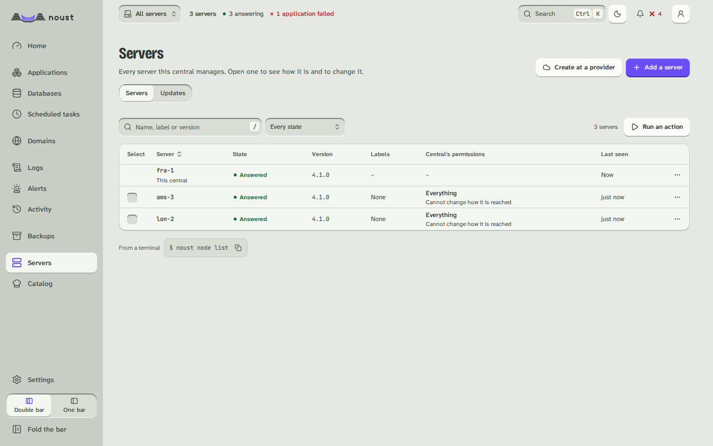

# Settings

Part of [The console, page by page](console.md).

Settings opens on a page that lists every section as a door, under the group that says what it is for, with one
line on what is inside and, where the console knows it, what is true now (how many people have an account, how many
roles there are, which version runs). The side list has the same seven groups, with a page per section:
**People and access**, **Notifications and channels**, **Connections**, **Security and frameworks**, **API**,
**Fleet** and **Noust**. They are the same on a lone server and on a fleet: a section the central keeps whichever
server you choose opens the central's page. From twelve sections the list has a filter that also finds a section by
the name it had before (Integrations, Accounts, ENS report), and on a phone the page it opens on is the index. Your own
password, authenticator app, passkeys and sessions are not here: they are **Account** and **Account > Sign-in
security**, in the avatar menu.

| Section | Group | What it has |
|---|---|---|
| General | Noust | Applications directory, web server, certificate email, backups, the server's name, and the console address `--open` links use; and **Deploy freeze**, which holds every deploy on the server for a stretch ([delivery.md](delivery.md#freezing-deploys)) |
| Channels | Notifications and channels | Whether notifications are on, at the top (amber when they are on but no channel is set up; see [Features that are on or off](console.md#features-that-are-on-or-off)); channels (webhook, Slack, Discord, Telegram, email, Pushover, ntfy, Gotify, Microsoft Teams, Mattermost, Matrix, Lark, PagerDuty) in drawers, with a test each; email by SMTP or through Resend, Postmark, Brevo or Amazon SES; per channel its own events, its route, quiet hours, a **cap on messages** and a **daily summary**; the record of deliveries with why one is held; which events notify, among them **Deployed with warnings** (`deploy_hook_failed`), **Application not answering** (`app_unreachable`) and **Application answering again** (`app_recovered`), all on by default; private destinations allowed |
| Connections | Connections | The GitHub App, the address for webhooks, the address and an entry to paste for a metrics scraper (Prometheus, Grafana Alloy, an OpenTelemetry Collector), and the server's **deploy keys** (each with the repositories it reaches and the applications built from them) and the **host keys it pinned**, which can be forgotten after comparing the fingerprint |
| Alert rules | (Alerts, an area of the bar) | Rules that fire when a measure stays past a limit for a while, the alerts firing now, and the built-in checks (disk, certificates, backups, patches, tokens) as boxes whose number shows only while they are on. A firing alert is **taken** by whoever is on call, with who and when, and **reopened**; the same buttons are in the inbox. See [notifications.md](notifications.md#alert-rules) |
| Logs and metrics export | Notifications and channels | Where the logs of applications are sent besides the journal: Grafana Loki, Axiom, New Relic, an HTTP endpoint, OpenTelemetry or a remote syslog; how each destination is doing and what it answered when it failed, verbatim; add, edit, turn off, test with one line, remove. See [runtime.md](runtime.md#log-shipping). Below it, **Keeping the logs**: how many days and how much disk the journal may take, whether it survives a reboot, and a way back to journald's defaults ([logs.md](logs.md)) |
| Probes and status page | (Alerts, an area of the bar) | Addresses the monitor asks from outside the application: where each stands, what it last answered, its uptime over a day, a week, a month and a quarter, its incidents, and a button to ask it now; and the **public status page** made of the ones marked public, kept up to date, titled, and put on a name of its own through a job. See [probes.md](probes.md) |
| Variables | Noust | The server's shared variables, which every application can refer to as `{{server.NAME}}`; the team's, the project's and the environment's are on their own pages (below) |
| Secret managers | Connections | Vault, Doppler and Infisical, which a variable refers to with `{{secret:NAME/path}}`: the address, the settings of the kind, the team that may name it and a token that is written and never shown again; **Test connection** proves it answers. A secret's value is fetched at every deploy and never kept. See [variables.md](variables.md) |
| About Noust | Noust | Version and updates; **Automatic updates** (whether this server installs Noust's own new releases by itself, the releases it takes, the hours and days, the next window and what the last run did; saving writes or removes a timer, in sudo mode; [release-policy.md](release-policy.md#updating-by-itself)); installation, CLI equivalents, links |
| Servers | Fleet | Every server, its reachability, version, ceiling and labels, and, under its state, how long it has been silent or why its monitoring is paused; **Add a server** takes an address and a credential used once, confirms the host key, installs Noust if it is missing and joins the server (below), or, a link away, walks through `noust fleet authorize` and the join code, or, for a server behind NAT, makes it dial in; **Create at a provider** opens the wizard of Settings > Cloud providers; test, pause monitoring and remove |
| Cloud providers | Connections | The provider accounts (Hetzner, DigitalOcean, Vultr) with their tokens as secrets, the servers this central created and why one did not join, and the cloud-init library new servers boot with (below) |
| Console address | People and access | Publishes the console on a name of its own over TLS, or takes it down (below) |
| MCP | API | Turns the endpoint for MCP clients on or off, switches its groups of tools, lists the tools with the permission each needs ([mcp.md](mcp.md)) |
| Manifest | API | Previews what applying a manifest of applications would change here, then applies exactly that as you ([manifest.md](manifest.md)) |
| API reference | API | Every route the server answers, with the permission it needs, what it takes and answers, a curl to copy, and a way to try the call with your own session (a change asks first; the status, the headers and the server's words are shown) |
| People | People and access | Accounts with all their roles, invitations (one email, and what the person may do; the console says whether the email went and always shows the link), separation-of-duties exceptions (with `accounts.read`) |
| Roles | People and access | One list of roles: the five Noust ships and the owner, and yours. Each is edited, duplicated and put back as it comes, except the owner, which holds everything and cannot be changed; a role nobody has been changed follows new versions of Noust, and an edited one is offered the new permissions instead of getting them in silence. A person holds one role or several, and **See what they can do** shows every permission and which role gives it. Below, who holds which role where (an environment, a project, a team, the server) (with `accounts.read`; [teams.md](teams.md#roles-where-they-are-needed)) |
| Image registries | Connections | The accounts the server pulls private images with, tested on demand; which application uses which is chosen in its Deploys settings |
| Fleet settings | Fleet | What the central shares with every server (channels, alert rules, backup destinations, image registries, shared variables), and for each server which of three levels it is on: it **follows** the fleet, it has an **exception** (set here, or a value its own operator changed, which can be put back), or it is **independent** and is pushed nothing. **Apply to the fleet** plans what would run and then follows each server in its own state |
| Single sign-on | People and access | The identity providers (OpenID Connect, SAML), directories and SCIM provisioning sources (added, tested, removed), the people linked to them, and the switch that turns passwords and passkeys off, naming the accounts that keep theirs ([sso.md](sso.md)) |
| Controls | Security and frameworks | The security profile in force and the sign-in policy; the compliance frameworks (ENS basic, medium and high, ISO/IEC 27001, NIS2, CIS, SOC 2, GDPR) and every control with its value and who forces it ([COMPLIANCE.md](COMPLIANCE.md)) |
| API tokens | API | Your tokens: issue (shown once), narrow, bind to a team, a project or an environment, list (with where each reaches and when it expires) and revoke |
| Approvals | People and access | Four-eyes requests: yours, and those waiting for you to decide |
| Audit log | Security and frameworks | The audit trail, its verification, destinations and reviews (with `audit.read`) |
| Frameworks | Security and frameworks | `noust ens check` and the evidence report |
| Central | Fleet | The role, the certificate and the seal |

**Add a server** opens on the guided way: a name, the address and port, the account (root, or one
with passwordless sudo), what the central may do there (read, deploy or admin, and whether it may
also manage the server itself), and how to get in, a password or a private key. The credential is
used once: it reaches ssh through its environment or a private memory-backed file, is never
stored, logged, kept in the job's record or put in the audit trail, and the page forgets it the
moment the request leaves. Before anything else is sent, Noust asks the address for its ed25519
host key and shows the fingerprint, to compare with `ssh-keygen -lf
/etc/ssh/ssh_host_ed25519_key.pub` on the server; the join must carry that same key. Then it is a
job whose output (the installer's included) streams in the dialog, ends on the server joined, and,
if it fails, shows ssh's own words and goes back to the details with the credential empty.
**Authorize it with a command on the server instead** is the way that never gives the central a
credential at all.

**Create a server** (Settings > Cloud providers, or Fleet > Servers > Create at a provider) is a wizard in
five steps: the name and the provider account; the location, size (with its processor and monthly price)
and image, read from the provider now; the options its create call has (public addresses, backups,
firewalls, networks, SSH keys of your own, boot scripts from the library, delete the machine if it does not
join); a review that says what it costs from the moment it is created and shows the cloud-init document it
will boot with; and the job, whose log streams until the server has joined. Adding an account asks for the
token once, checks it with the provider and never shows it again, only its last four characters; the servers
created here stay on the page with the reason when one did not join, and can be powered on or deleted at the
provider (the name typed to confirm).

**A server behind NAT** (Add a server, then "It cannot be reached from outside") is added in three steps:
the name and the address it will dial, which gives it a port of this central and the command to run on it
(with this central's SSH host key, to compare by eye); the link code it printed; and the result, once it has
connected and answered. If this central has not been prepared for it, the dialog says what is missing and the
command that fixes it (`noust node link setup`). A server that dials in shows "Dials in: port N of this
central" where another shows its SSH address.

**Console address** publishes the console at a name that points at this server: an nginx site, a
Let's Encrypt certificate, the console told to trust nginx, and an allow-list if you give one;
there is no plain-HTTP form. The page lists what is checked first (a second factor on every
account that can sign in, with the accounts that lack one named; the ENS profile, which keeps the
console on loopback unless you force it with an allow-list; a name that is not an application's
or a site Noust did not write), the dialog previews what will be done, and publishing and
unpublishing are jobs followed in the page (sudo mode). Unpublishing removes exactly what
publishing made and leaves what was already there.

On a server without a fleet, every section is the server's own. What a server's own accounts,
tokens and second factor are cannot be changed from a central; the page says how to manage them
on the server.

Writing any setting needs sudo mode.
