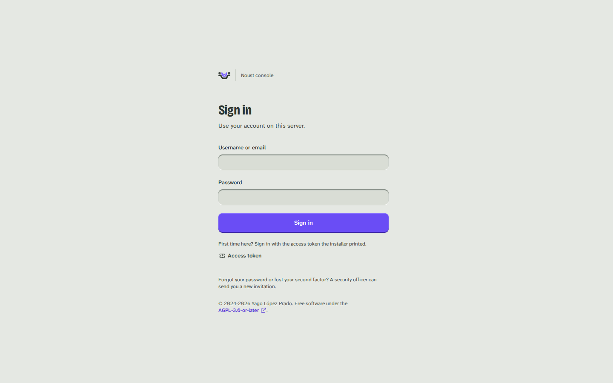

# Start the console and sign in

Part of [The console, page by page](console.md).

## Starting it

```bash
noust web start           # foreground, 127.0.0.1:8080; prints the access token; Ctrl+C stops it
noust web start -d        # background until 'noust web stop' or the next reboot; prints the token
noust web enable          # a systemd service: survives reboots; prints the token
noust web token --new     # issue a token to sign in with
noust web status          # running or not, and whether as the service or in the background
noust web stop
```

Every start issues a new access token and prints it once, in the same banner whichever way
the console runs: in the foreground, in the background with `-d` (the parent process prints
it before handing the server over to the child), or as a service with `noust web enable`. It
is never silently issued unseen, and systemd starting the service again (at boot, after a
failure, after an upgrade) issues none: it keeps serving the token `noust web enable`
printed. `noust web token` without options only reports whether a token is issued: the token
itself is stored as a salted hash and cannot be shown again. A running console reads the
token from disk on every request, so issuing a new one with `noust web token --new` retires
the old one at once, with no restart needed; see [security.md](security-sign-in.md#authentication)
for more, including what `--regenerate` invalidates beyond the token itself.

A foreground console runs until you press Ctrl+C or close the SSH session it was started
from; its banner says so, and prints the `noust web enable` line that would keep it running
with the same options. `noust web start -d` runs it as a background process, with its log in
`/var/log/noust/web.log` and its PID in `/run/noust-web.pid`: it does not start again
after a reboot. `noust web restart` takes the same options as `start` and does not remember
the ones used before: pass them again.

### Keep it running

`noust web enable` runs the console as a systemd service, `noust-web.service`: started now,
started again at every boot, and restarted if it fails.

```bash
noust web enable                                  # 127.0.0.1:8080, reached over SSH
noust web enable --host 0.0.0.0 --self-signed     # any option 'noust web start' takes
noust web status                                  # Runs as: noust-web.service (starts at boot)
journalctl -u noust-web                           # its log
noust web disable                                 # stop it, disable it and remove the unit
```

- It takes the options `noust web start` takes, checked by the same rules: binding beyond
  loopback without TLS is refused here too, before anything is written. There is no `-d`:
  systemd keeps it running.
- It writes `/etc/systemd/system/noust-web.service`, whose `ExecStart` is this machine's
  `noust` binary running the console in the foreground with those options, then enables and
  starts it, waits until it listens, and only then prints the access token and how to reach
  it. If it does not come up, the journal is shown instead, and no token is issued.
- The token is printed on your terminal by `noust web enable`, never by the service: the
  service's output is the journal, which more accounts can read than root. The unit file
  holds no credential either. A lost token is replaced with `noust web token --new`, which
  the running service accepts at once.
- To change the options, run `noust web enable` again with the new ones: the unit is
  rewritten and the service restarted. `noust web disable` removes it; the token and the
  console's state under `/etc/noust` stay.
- While the service runs, `noust web start` and `noust web restart` refuse to start a second
  console and name the service, and `noust web stop` points at `noust web disable` (or
  `systemctl stop noust-web`, which stops it until the next boot).
- A console already running with `-d` has to be stopped first (`noust web stop`), so the
  service can take its port.
- The service runs as root with systemd's own `PATH`, like every other unit. The unit's
  hardening leaves everything the console does as root intact (installing packages, writing
  `/etc`, deploying into `/var/www`); the template explains each directive.
- Upgrading the package restarts a running `noust-web.service` onto the new version;
  removing the package stops and disables it.

If the console's Python packages are missing, `noust web start` says which and offers to
install them; `noust web install --apt` or `--pip` installs them directly.

### Reaching it

The console acts as root, so it listens on loopback unless you give it TLS.

**Over SSH (the default and the safest).** Leave it on `127.0.0.1` and forward the port from
your own machine. `127.0.0.1` answers on the server itself and nowhere else, so opening the
server's address in a browser will not reach it; the banner prints the exact line to run:

```bash
ssh -L 8080:127.0.0.1:8080 root@server.example.com
# then open http://localhost:8080
```

**With TLS served by Noust.** Binding to anything but loopback requires a certificate:

```bash
noust web enable --host 0.0.0.0 --tls-cert /etc/letsencrypt/live/panel.example.com/fullchain.pem \
                               --tls-key /etc/letsencrypt/live/panel.example.com/privkey.pem
noust web enable --host 0.0.0.0 --self-signed   # minted under /etc/noust/panel-tls, reused while valid
```

**Behind a reverse proxy that terminates TLS.** Keep the console on loopback and declare the
proxy, so the session cookie is marked `Secure` and client addresses are the real ones:

```bash
noust web enable --trusted-proxy 127.0.0.1
```

**On a name of its own, over TLS (guided).** For a browser without a tunnel:

```bash
noust console expose --domain console.example.com --allow-ip 203.0.113.0/24 --allow-ip 198.51.100.7
noust console status                    # where it answers, and whether everything is still in place
noust console unexpose                  # removes exactly what expose made
```

`expose` writes an nginx site for the name (Noust's own, marked "Generated by Noust"), obtains
a Let's Encrypt certificate for it, makes the console believe nginx's forwarding headers (the
service gets `--trusted-proxy 127.0.0.1` and restarts), sets `web.public_url` to the name and
`web.allowed_hosts` to answer only it. nginx replaces `X-Forwarded-For` with the address it saw,
so nobody can pick the one the rate limit and the lockout are keyed on, and `--allow-ip` is
enforced there: everyone else is refused before the console sees them. Before it writes anything
it checks, and refuses with what to do:

- **a second factor on every account**: any account that can sign in with a password alone
  stops it (before any account exists, the access token's own second factor must be on);
- **the name**: not an application's (no application site is edited), not a site Noust did not
  write, and resolving to this server's addresses (`--skip-dns-check` for a server behind NAT);
- **the ENS profile**: the console stays on loopback unless `--force-ens` is given, confirmed,
  with `--allow-ip`; the override is audited (`console.expose` records `forced_ens`);
- **the console is a service** (`noust web enable`), and this is not a hub (a hub has no nginx;
  it serves its own TLS, see [CENTRAL.md](CENTRAL.md#the-consoles-certificate)).

There is no plain-HTTP form: until the certificate exists the site answers 404 to everything
but the challenge. A step that fails undoes what this run made, and `unexpose` removes only what
the record says Noust created: the site and the certificate when it made them, the trusted proxy
when it added it, and `web.public_url` and `web.allowed_hosts` while they still hold what it
wrote. The break-glass access token still signs in at the new address: keep it offline.

Over the API it is `GET`, `POST` (a job) and `DELETE` (a job) on `/api/console/exposure`, and
`POST /api/console/exposure/preview` to see the checks' answer without changing anything. Both
changes ask for sudo mode and `server.host_access`; the console restarts a few seconds after the
job ends.

Every example here works with `noust web start` as well, for a console that should not
outlive the session.

`--allow-ip ADDR/CIDR` (repeatable) restricts who may connect at all. `--insecure-http` serves
cleartext beyond loopback; the token and the session cookie then cross the network
unencrypted. See [security.md](security.md) for the full rules.

### Signing in



Sign in with your account: username, password and a code from your authenticator app, or a
passkey on its own. Browsers offer passkeys only on a certificate they trust, so over an SSH
tunnel or with a self-signed certificate the page says why the button is missing. The page does
not show the host name or the version before you sign in; `auth.login_label` sets a line that
tells your servers apart. After signing in, the console says when and from where you last signed
in and how many attempts failed since.

**A server with no accounts** signs in with the access token (the **Access token** button, or the
link the installer printed, which opens the page on its field) and then opens one form that
creates the first administrator and signs in with it: a username and a password, with the name and
the email a click away. The console then offers to **Protect your account**, which can wait (**Set
up later**) unless a compliance framework asks for a second factor or the console is published.
Once an account exists, the access token is emergency access: it still signs in, and each use is
recorded. An invited person opens the invitation link, chooses a password and sets up a second
factor; where the server can send mail the invitation dialog also mails the link, and the sign-in
page offers "Forgot your password?", which mails a link that needs the authenticator as well. An
account sets up a second factor, an authenticator app or a passkey, at its first sign-in, before it
can do anything else, when a compliance framework asks for one or the console is published or
listens beyond loopback; elsewhere it is set up at **Account > Sign-in security** whenever the
person likes. When `auth.notice.text` is set, a notice of rights and
obligations is shown and must be accepted.

A session ends after 30 minutes without activity and 12 hours after sign-in (`auth.session.*`).
Five failed attempts lock the account for 15 minutes, and five from one address lock that
address; the page counts down.

## Sudo mode

Destructive and credential-changing actions (deleting anything, restoring a backup, revealing
or editing an `.env`, moving to instant rollback, changing limits, editing a unit or a site,
writing an application's deploy hooks, adopting a Compose stack, SQL in write mode, server
changes, managing accounts, changing settings, issuing a token) ask
you to confirm it is you: a dialog titled "Confirm it's you" asks for your passkey, or a code from
your authenticator app or one of your backup codes (for the access token, its code, or the token
itself when it has none). You already gave your password and a code when you signed in, so one
factor is enough, unless the server asks for the password again (`auth.sudo.require_password`,
always under the ENS profile), in which case the dialog also shows the password field. The
confirmation stays open while you keep working: every destructive action extends it, for up to 2
hours from when you confirmed (15 minutes without one, 2 hours at most, under `auth.sudo.*`; 10 and
30 under the ENS profile), and the dialog says so with the server's numbers. The action you were
taking is retried once confirmed. Flows that already know they need it, such as deleting an
application, ask before their own confirmation dialog, so only one is ever on screen.

When approvals are on, an action that needs a second person becomes a request instead of
running: the console says so, it appears under Settings > Approvals for whoever may decide it,
and once approved you run it again from the same place, once.
