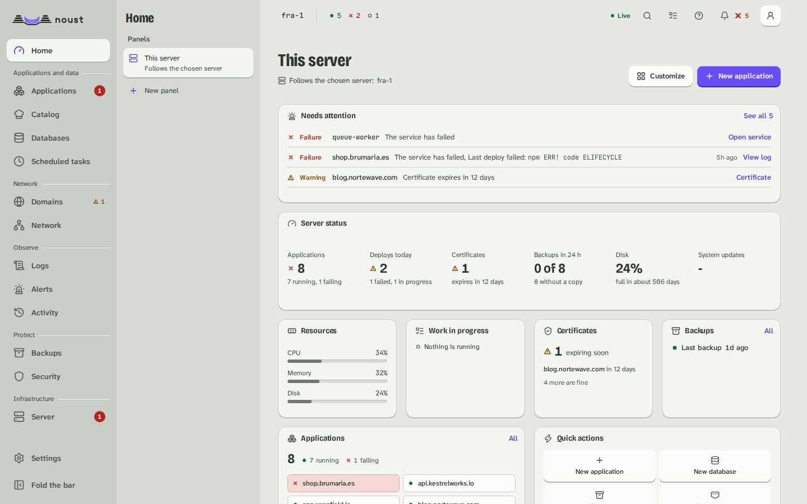

# The console

The Noust console is the browser interface to a server running Noust. It is a single-page
application built into the package and served by `noust web start`: no Node, no build step
and no CDN at install time, and nothing is loaded from any other origin at run time. It is a
client of the same [API](api.md) scripts use, so everything on screen is something the API
can do.

Each part of the console has a page of its own:

- [Start the console and sign in](console-start.md)
- [Overview, charts, activity and logs](console-overview.md)
- [Fleet](console-fleet.md)
- [Applications: the list, recipes and each application](console-applications.md)
- [Domains](console-domains.md)
- [Databases](console-databases.md)
- [Backups](console-backups.md)
- [Server](console-server.md)
- [Settings](console-settings.md)
- [Keyboard](console-keyboard.md)
- [Accessibility](console-accessibility.md)

## Layout

- **Sidebar**, in three groups: what runs (Overview, Projects, Applications, Databases, Domains,
  Backups and Cron), what happens (Logs and Activity) and the machine (Server). Projects is where
  teams, projects and environments live, and appears once they matter on the server. Settings is at
  the bottom. On a narrow screen the sidebar becomes a menu.
- **The scope selector**, at the head of the sidebar (in the top bar on a narrow screen), on a central
  or a server that has others: one server, **All servers** (the fleet) or **This central** (its own
  servers, security and tokens). The sidebar follows it: **All servers** and **This central** list the
  fleet's seven pages, Overview, Servers, Applications, Certificates, Backups, Updates and Activity.
  `/n/<server>/...` keeps the choice across a reload, the last server is remembered, and every page for
  one server shows its name above the title. A lone server draws no selector.
- **Tasks**, the icon of the top bar that counts what is running, from any page. Its panel lists yours
  (running, then queued), what the server is doing that you did not start (a backup, someone else's
  deploy, a restart), and what ended lately with its result: a failure says where it stopped and what the
  tool printed, as it printed it. A row shows its last lines of log when asked and opens its own page
  (**Activity > Tasks**): the steps of a deploy, who started it and where, its log as it is written, and
  Pin, Cancel and Try again where they apply. **Pin** keeps a running task as a small chip at the foot of
  every page, with its progress, until you let it go; nothing is pinned by itself. When a task of yours
  ends while you are on another page, one notice says so with **See** (on its own page it says nothing);
  the first time you leave a long task of yours the console offers the browser's notification, which only
  turns on if you say yes. On **All servers** the panel is grouped by server, and a server that has not
  been updated says it will count its tasks when it is.
- **Top bar**: the machine strip (host name, uptime, load, CPU, memory, disk, units running and
  failed), the command palette, the **inbox** and the session menu (account, sign-in security, theme,
  language, keyboard shortcuts, sign out). The inbox is a bell: **Needs you** lists what is wrong while
  it is wrong (a failed application, a certificate about to expire, an alert that fires, a probe that is
  down, a request waiting for your decision, a Noust or a recipe with a newer version), each row with
  one button that goes to it, and **Recent** keeps the last 30 things the server said while this tab
  was open. The history is Activity.
- The browser tab is titled `<page> - <hostname> - Noust`.

Every page follows one of the templates in [DESIGN.md](DESIGN.md): a list, a detail page with
tabs, settings with a side navigation, the dashboard, a wizard, a file editor, or the sign-in
column. Colour means state and nothing else: green running, amber in progress, red failed, grey
stopped, and violet for what you can interact with; chart series have a palette of their own.
Every state also has a shape and a text label. When a system tool fails, its own output is shown
verbatim in a monospace block, with the suggested fix above it.

## Features that are on or off

A page that configures a feature says its state beside the setting, as a pill: a colour, a glyph and a
word at once, so it reads without reading the sentence under it. The setting is a row, with the
switch at its end and, when turning it on or off has a risk, the risk in one line and the confirmation
that goes with it.

| State | Shown as |
|---|---|
| On | The running green, a glyph and "Enabled" |
| Off | Grey, a glyph and "Disabled", with what being off means for you |
| On with a problem | Amber and a warning triangle, never green: it is on but cannot do what it says ("Enabled, but no channel"), with the action that fixes it |

The state is a row on Settings > Channels, Console address, MCP, Approvals and Automatic updates (in
About Noust), the second factor in Account > Sign-in security, scheduled backups on the Backups page,
automatic updates on Server > System and updates, and in an application's settings for instant rollback,
zero-downtime deploys, builds in the sandbox and pull request previews. See [DESIGN.md](DESIGN.md).

## Live updates

The console holds one Server-Sent Events stream for the machine strip, charts, application
states, job progress and notifications, and opens a WebSocket for a log or a running job
while you look at it. The machine strip says **Live** while that stream keeps the readings current and **Reconnecting** when it
does not. If the connection drops it reconnects with backoff and refreshes
everything it shows. Log viewers render ANSI colours, search, follow the newest line (pausing
when you scroll up, with a "Jump to latest" button), wrap, copy and download. When the output has
levels, a chip for each (error, warning, info, debug, with its count) keeps only the levels you
choose, the line numbers stay those of the whole output, and copy and download take what is shown;
the time column can be hidden, and the viewer can take the whole screen.

A job runs on a thread of the console, so a console that restarts ends the jobs it was running:
they are marked "Interrupted by a panel restart". The exception is work that runs in a transient
systemd unit of its own (applying operating system updates, and Noust updating itself), which
keeps going when the console restarts, and a `noust` package among the updates is precisely what
restarts it. The job records its unit, and the console that starts again follows it
instead of failing it: when the unit ended well the job completes with the unit's output appended
to its log, when it failed the job fails with systemd's result and the unit's own words, and when
it is still running the job stays running, its log grows as the unit writes, and it ends with the
unit, or gives up after a deadline and says how to follow it. A job with no unit recorded is still
marked interrupted.

## Themes

Light, dark, or the system's (the default), from the session menu or the command palette.
The choice is kept in the browser's local storage (`noust.theme`) and applies to every open tab.

## From the terminal

`--open` on `noust list`, `noust status`, `noust logs`, `noust db list`, `noust backup list` and
`noust monitor status` prints the matching console URL, and opens it when a display is
available. The address comes from `web.host` and `web.port` in the configuration (Settings >
General), which only affect these links: where the console listens is decided by the options
of `noust web start`.
