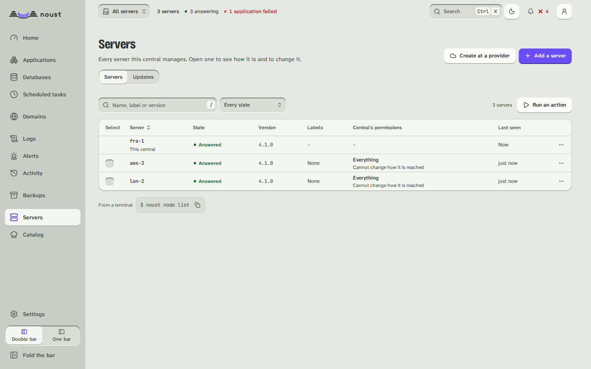

# Add a server to your fleet

**Goal:** a second server managed from the console of the first, without giving the first one a
shell on it.

**Time:** five minutes.

**You need:** two servers with [Noust installed](install.md), a second factor on your account on
the first one ([Make it safe to leave alone](first-safety.md), step 4), and the first server able to
reach the second's SSH port.

Kelmoor runs its console on `fra-1`, the server it already has, and adds `ams-3`, at
`203.0.113.24`. The server whose console manages the others is the *central*; each server it
manages is a *node*.

## How it works

The central opens an SSH tunnel to each node and drives it through the node's own API, so it
re-implements nothing. It logs in as `noust-tunnel`, an account the node creates for it, which
sshd restricts to forwarding one port: no shell, no command, no other forward. The node decides how
far the central may go, and can withdraw it on its own.

A server that already deploys applications can be a central as it is: nothing to change on `fra-1`.

## Steps

1. **On the central, ask for the node's key.**

   ```bash
   noust node key ams-3
   ```

   It prints a key made for `ams-3` alone and the command that authorizes it there. In the console:
   **Fleet > Servers > Add a server**.

2. **On the node, as root, run the command it printed.** It looks like this:

   ```bash
   noust fleet authorize --central-key 'ssh-ed25519 AAAA...' --name fra-1
   ```

   It creates the `noust-tunnel` account and its sshd block, installs the key for it, checks with
   `sshd -T` that the restrictions are in force, keeps the node's console on `127.0.0.1` as a
   service, and prints a **join code** on one line. Your own access token to `ams-3`'s console keeps
   working.

   To limit what the central may do there, add `--access read` (look only) or `--access deploy`
   (operate and update applications). The default is `admin`; the host itself (SSH keys, sshd, the
   firewall) stays out of reach unless you add `--allow-host-access`.

3. **On the central, add the node with the join code.**

   ```bash
   noust node add ams-3 --ssh 203.0.113.24
   ```

   Paste the join code when it asks; it is not shown as you type. The central pins `ams-3`'s host
   key from the code, opens the tunnel and checks the token. A host key that changes later closes
   the tunnel instead of being accepted.

4. **Check it end to end.**

   ```bash
   noust node test ams-3
   noust fleet status
   ```

## What you should see

`noust node test ams-3` passes the tunnel, the token and the API. `noust fleet status` lists
`ams-3` with its version, applications and certificates.

In the console, the selector at the top now offers **All servers** and each server by name.
**All servers** shows them side by side, what each runs and what needs attention; choosing
`ams-3` switches the whole console to it.



## With a password instead

When the node is new and you only have its address and its root password, the central can do the
three steps itself, once:

```bash
noust fleet enroll ams-3 --host 203.0.113.24
```

It shows the node's host key fingerprint for you to compare with the one the provider shows, asks
for the password without echo, installs Noust there if it is missing, and then reaches the node
only through the tunnel. The password is used for those few connections and kept nowhere.

## If it fails

- **`noust node add` refuses because two-factor sign-in is not enabled:** a central does not add
  its first server until your account has a second factor. Add it (step 4 of
  [Make it safe to leave alone](first-safety.md)) and run the command again.
- **The tunnel does not open:** `noust node test ams-3` prints ssh's own words. Check that `fra-1`
  reaches `203.0.113.24` on port 22, and that sshd on `ams-3` is OpenSSH 7.8 or later.
- **`noust fleet authorize` says a setting differs:** another sshd file or `Match` block overrides
  the restriction it wrote. It put the change back; the message names the setting and the file.
- **A server behind NAT, or reached through a bastion:** [Add servers to a central](central-servers.md)
  covers both. [Run a central](CENTRAL.md) covers running it in a container on a NAS.

## Next

[Move your applications from Coolify or Dokploy](first-move.md), or see
[Next steps](next-steps.md).
