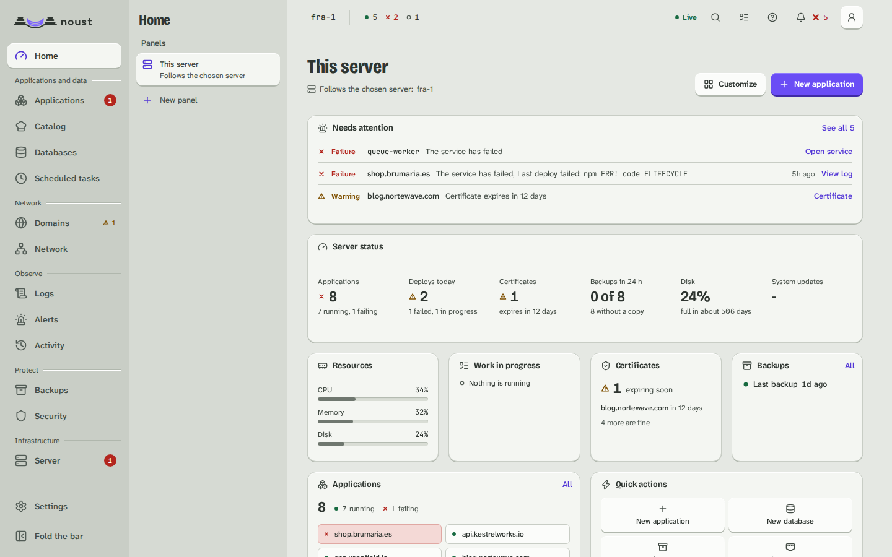

# What Noust is, and when it is not for you

Noust deploys web applications onto Linux servers you own and keeps them running. You give it a
repository and a domain. It builds the application, runs it as a systemd unit behind nginx or
Apache, and gets it a certificate. From then on, every deploy is a new release that only goes live
if it answers, and the previous one comes back in seconds if you need it.

You drive it from the command line, from a console in the browser, or through its JSON API. All
three do the same things, because the console and the API call the same code the command line
does.

## What you get

- **Deploys that do not take a site down.** Each deploy builds a new release next to the one that
  serves, and only replaces it once it answers its health check. If it does not, the old release
  keeps serving and you get the error, the probes and the application's own log.
- **A way back.** `noust releases rollback` puts the previous release back without rebuilding.
- **HTTPS by default.** Each domain gets a Let's Encrypt certificate, renewed before it expires.
- **Databases and backups.** PostgreSQL, MySQL, MariaDB, Redis, Valkey and MongoDB, each database
  with an account of its own. Backups go to one file you can restore anywhere, and can be copied,
  encrypted, to another place.
- **A console for a team.** Accounts and roles, passkeys and two-factor sign-in, approvals by a
  second person and an audit log that shows if anyone tampers with it.
- **Several servers from one place.** One Noust server can manage your others over SSH tunnels,
  with no shell on any of them.
- **The server itself.** Operating-system updates, the firewall, SSH, disks and swap, from the same
  console.

## Nothing hidden

Every application is a systemd unit you can read with `systemctl` and `journalctl`. Every site is a
file in `/etc/nginx` or `/etc/apache2`. Applications run as ordinary processes, so Docker is only
needed for a Docker Compose project or a container application. If you remove Noust, your
applications keep running: [Taking Noust away](concepts.md#taking-noust-away) says what stays.

## It fits when

- You run one server or a few: a VPS or a machine of your own, on Ubuntu, Debian, Fedora, openSUSE
  or the RHEL family ([the full list](PLATFORMS.md)).
- You deploy web applications: Node.js and its frameworks, Python, PHP, Ruby, Go, Rust, Java, .NET,
  Elixir, static sites, Docker Compose projects or container images.
- You want to own what runs, see it, and be able to leave.
- You want a console for the people who use the servers, and a command line and an API for the
  scripts.

## It is not for you when

- **You need a cluster.** Noust does not move work between machines when one fails, and it does not
  schedule containers across a pool. Each server runs its own applications. For that, look at
  Kubernetes or Nomad.
- **You do not want to run a server at all.** Noust gives you the tools to look after one, but the
  server is still yours: its disk, its updates, its bill. A managed platform takes that away.
- **You host code you do not trust.** Each new application runs as an account of its own and cannot
  read another's files, but they share the kernel and the machine. Noust is not a sandbox between
  tenants: deploy only code you would run on a server you administer.
- **Your servers run Windows or macOS,** or a Linux that is not on [the list](PLATFORMS.md).

## What it costs

Noust is free software under the GNU Affero General Public License, version 3 or later. It sends
nothing about you or your servers anywhere. [Privacy](PRIVACY.md#the-one-request-noust-makes-without-being-told-where)
names the one request it makes on its own, to check for new releases, and how to turn it off.

## Next

[Install Noust](install.md). It takes one command and about a minute.
